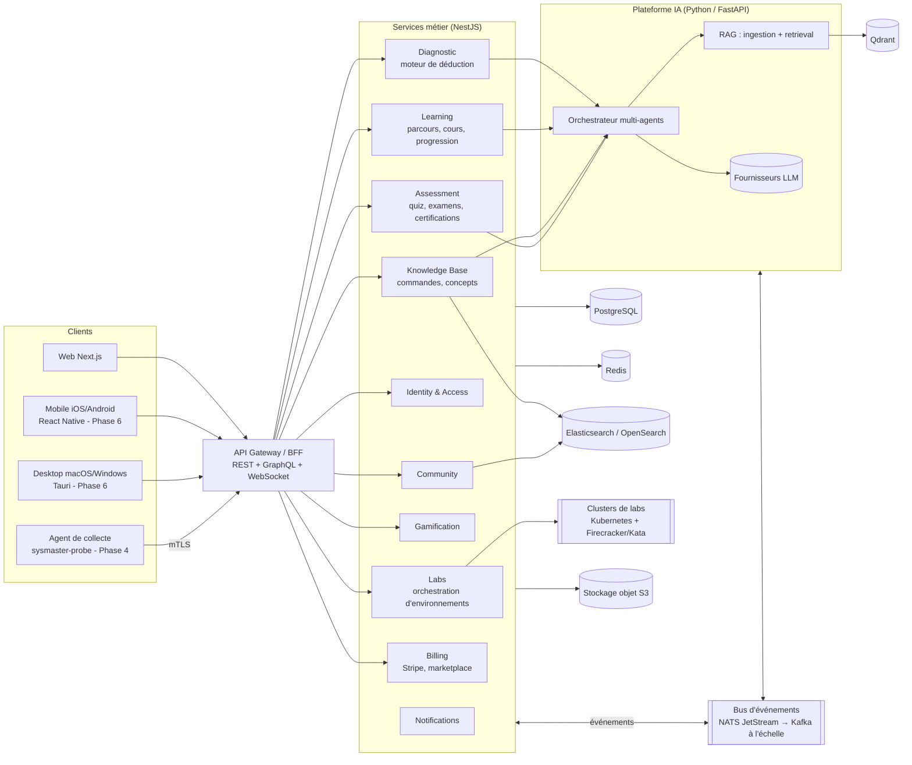
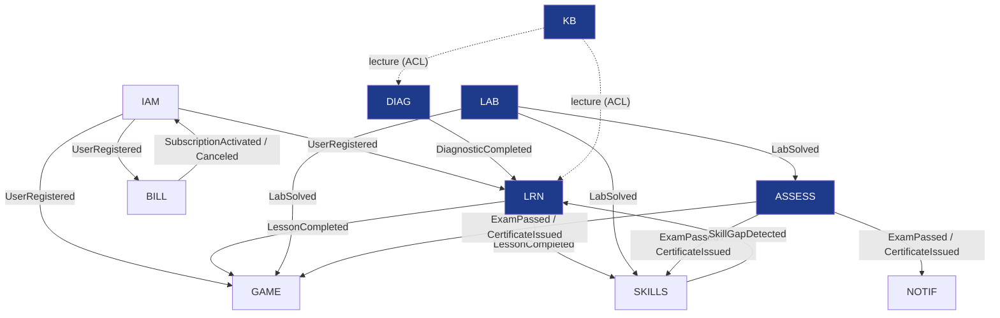
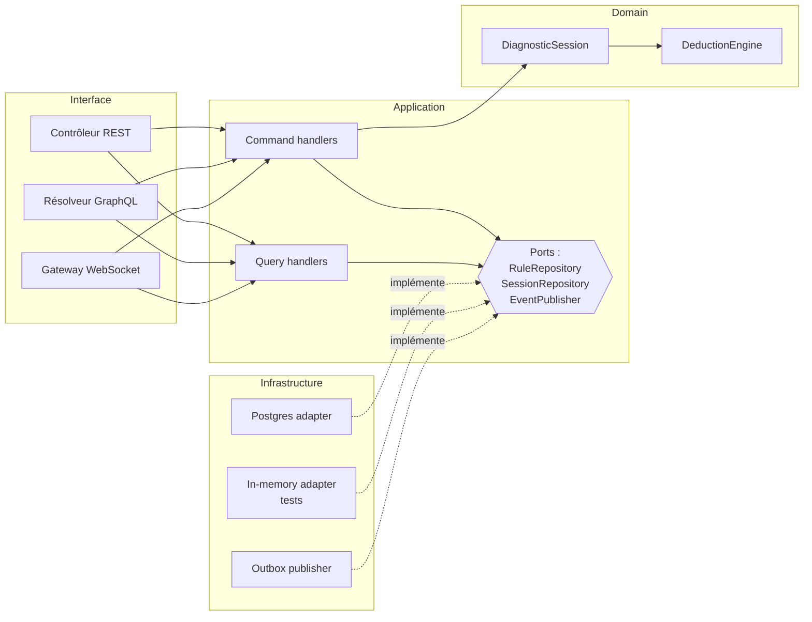
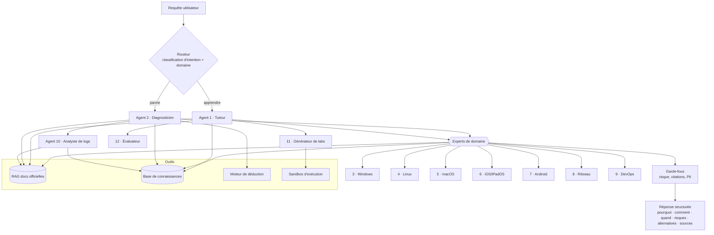
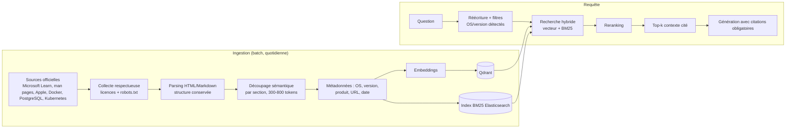
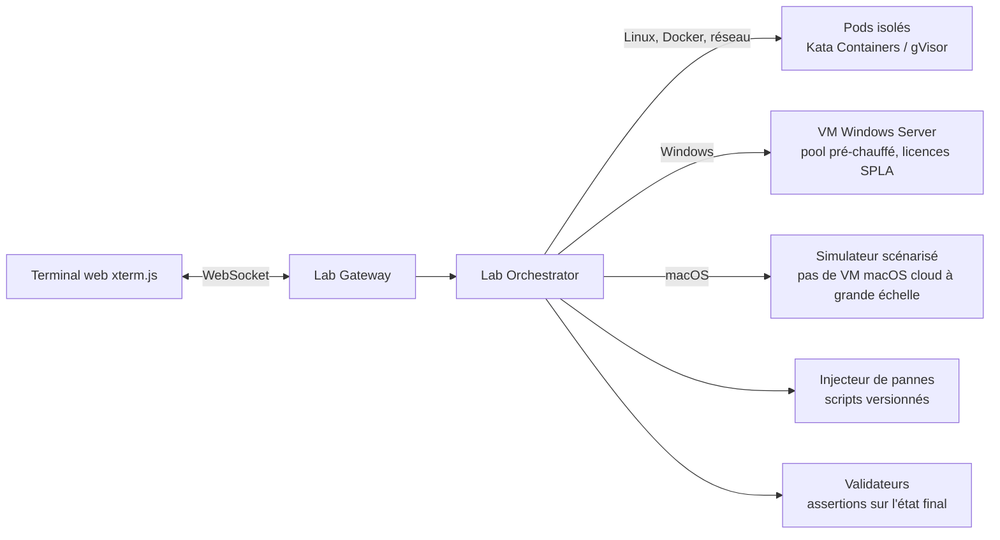
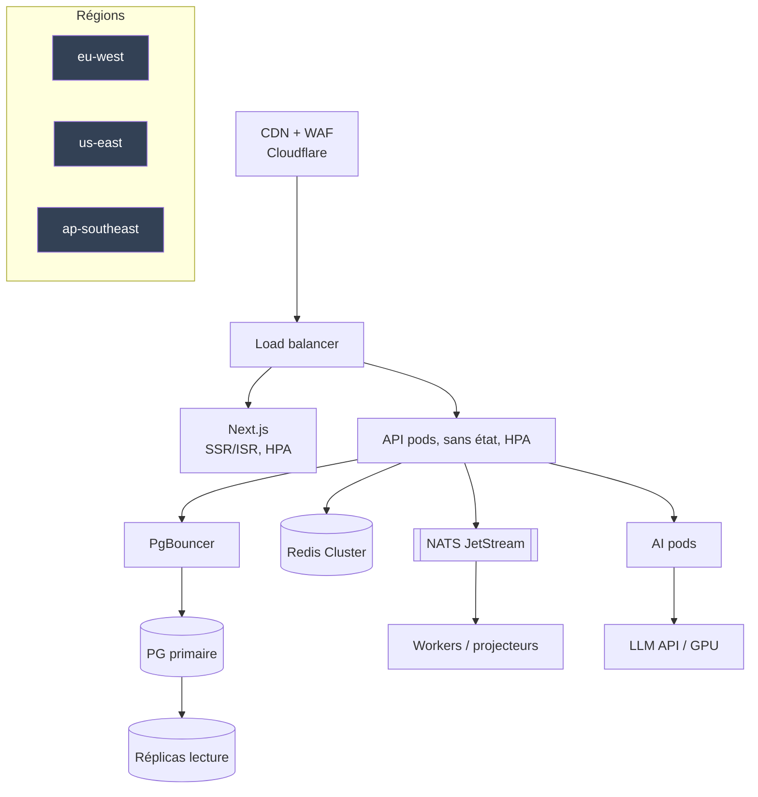
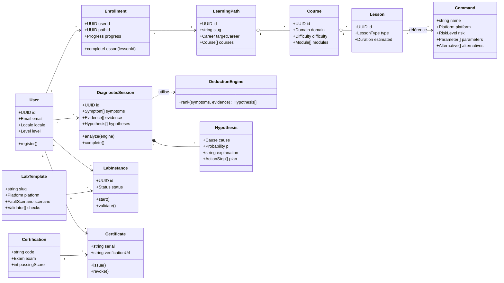
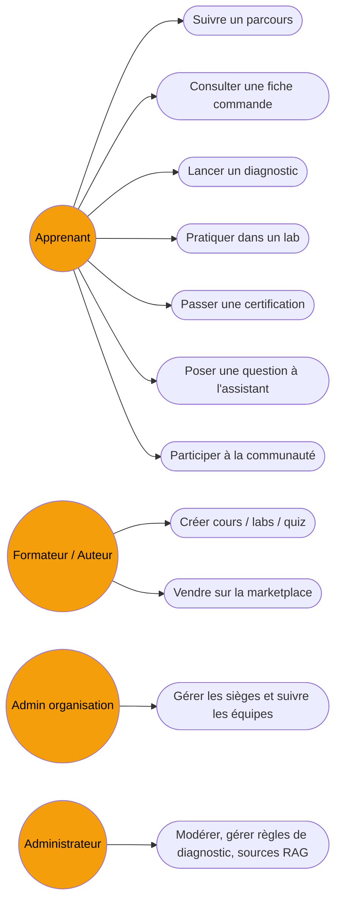

# 01 — Architecture de SysMaster AI Platform

> Statut : Phase 1 (fondations). Ce document décrit l'architecture **cible** (plusieurs millions d'utilisateurs) et précise, pour chaque élément, ce qui est déjà présent dans le monorepo de départ et ce qui arrive dans une phase ultérieure.

Fidèle à la philosophie du produit, chaque choix est présenté avec **pourquoi**, **les alternatives écartées** et **les risques**.

---

## 1. Vue d'ensemble

SysMaster combine cinq produits en un : une académie, un laboratoire, un assistant IA, un diagnostiqueur et un centre de certification. Ces produits partagent les mêmes utilisateurs et le même référentiel de compétences, mais évoluent à des rythmes différents. L'architecture découpe donc le système selon les **domaines métier** (DDD), pas selon les couches techniques.



---

## 2. Découpage DDD : bounded contexts

| Contexte | Responsabilité | Agrégats principaux | Type |
|---|---|---|---|
| **Identity & Access (IAM)** | Comptes, connexion (email, Google, Microsoft, GitHub, Apple), 2FA, passkeys, rôles, organisations | `User`, `Organization`, `Membership`, `Role` | Générique (s'appuie sur un fournisseur) |
| **Learning** | Parcours, modules, leçons, progression, recommandations | `LearningPath`, `Course`, `Lesson`, `Enrollment` | **Cœur** |
| **Knowledge Base** | Fiches commandes et concepts (nom, utilité, historique, fonctionnement interne, paramètres, risques, alternatives…) | `Command`, `Concept`, `Article` | **Cœur** |
| **Diagnostic** | Sessions de diagnostic, symptômes, collecte de preuves, moteur de déduction, plans d'action | `DiagnosticSession`, `Symptom`, `Cause`, `Rule` | **Cœur (différenciant)** |
| **Labs** | Catalogue de labs, scénarios de panne, instances éphémères, validation automatique | `LabTemplate`, `LabInstance`, `FaultScenario` | **Cœur** |
| **Assessment** | Quiz, examens, banques de questions, certifications, vérification publique | `Quiz`, `Exam`, `Attempt`, `Certificate` | **Cœur** |
| **Skills** | Référentiel de compétences partagé (graphe compétence → prérequis) | `Skill`, `SkillScore` | Support |
| **Gamification** | XP, niveaux, badges, défis, classements | `XpLedger`, `Badge`, `Challenge` | Support |
| **Community** | Forum, Q&R, partage de labs/scripts, mentorat, groupes d'étude | `Thread`, `Post`, `StudyGroup` | Support |
| **Billing** | Abonnements Stripe, coupons, factures, affiliation, marketplace | `Subscription`, `Plan`, `Payout` | Générique (Stripe) |
| **Notifications** | E-mail, push, in-app, WebSocket | `Notification` | Générique |
| **AI Platform** | Agents, RAG, mémoire de conversation, garde-fous | `Conversation`, `AgentRun`, `Document`, `Chunk` | **Cœur** |



**Pourquoi DDD ici ?** Le vocabulaire varie fortement selon le contexte : une « session » est une session de diagnostic dans *Diagnostic*, une instance de VM dans *Labs*, une tentative dans *Assessment*. Des contextes séparés évitent un modèle unique et confus.

**Relations entre contextes** : *Knowledge Base* est un **fournisseur publié** (Open Host Service) lu par Learning et Diagnostic. *Billing* est protégé par une **couche anti-corruption** autour de Stripe, pour que le vocabulaire Stripe (`price`, `invoice_item`…) ne fuie pas dans le domaine.

---

## 3. Architecture hexagonale (ports & adaptateurs)

Chaque service suit la même structure. Le monorepo l'applique déjà au module *Diagnostic* et *Knowledge Base* de `apps/api`.

```
modules/diagnostic/
├── domain/          # Entités, value objects, règles, événements. Aucun import de framework.
├── application/     # Cas d'usage (commandes + requêtes), ports (interfaces)
├── infrastructure/  # Adaptateurs : Postgres, Redis, LLM, Stripe, bus…
└── interface/       # Contrôleurs REST/GraphQL/WebSocket, DTO, validation
```



**Pourquoi ?** Le moteur de déduction, les règles de progression ou le calcul d'XP doivent être testables sans base de données ni LLM. Les fournisseurs (LLM, base vectorielle, paiement) changeront : seuls les adaptateurs bougent.

**Risque** : la cérémonie (interfaces, mappers) ralentit les fonctionnalités triviales. **Atténuation** : les contextes génériques (Notifications, CRUD d'administration) peuvent rester en architecture en couches simple.

---

## 4. Microservices : quand et comment

**Choix : « monolithe modulaire d'abord, microservices ensuite ».**

| Option | Avantages | Inconvénients | Décision |
|---|---|---|---|
| Microservices dès le jour 1 | Scalabilité indépendante | Coût d'exploitation énorme avant d'avoir des utilisateurs, frontières mal placées très coûteuses à corriger | Écarté pour la Phase 1 |
| Monolithe classique | Simple | Les frontières se dissolvent, extraction future douloureuse | Écarté |
| **Monolithe modulaire** (un déploiement, modules isolés, communication par événements) | Simple à exploiter, frontières déjà nettes, extraction mécanique | Une seule unité de déploiement au début | **Retenu** |

Règles qui rendent l'extraction possible plus tard :
1. Un module n'importe **jamais** le domaine d'un autre module, seulement son API publique (contrats dans `packages/contracts`).
2. Chaque module possède son **schéma PostgreSQL** (`learning`, `kb`, `diagnostic`…). Pas de jointure SQL entre schémas.
3. La communication entre modules passe par des **événements** (outbox) ou des requêtes explicites.

Ordre d'extraction prévu (selon la charge réelle) : **AI Platform** (déjà séparé, Python, GPU), **Labs** (orchestration lourde), **Diagnostic**, **Community**, puis le reste.

---

## 5. CQRS

Les écritures et les lectures ont des profils très différents : un tableau de bord de progression agrège des dizaines de tables ; une validation de leçon modifie une ligne.

```mermaid
sequenceDiagram
  autonumber
  participant UI as Web
  participant API as Command API
  participant DB as PostgreSQL (écriture)
  participant OB as Outbox
  participant BUS as Bus d'événements
  participant PRJ as Projecteurs
  participant RM as Read models<br/>(Postgres vues / Redis / ES)
  UI->>API: POST /lessons/:id/complete
  API->>DB: BEGIN; UPDATE enrollment; INSERT outbox(LessonCompleted); COMMIT
  OB-->>BUS: relais (polling / CDC Debezium)
  BUS-->>PRJ: LessonCompleted
  PRJ->>RM: met à jour dashboard_progress, leaderboard, xp
  UI->>API: GET /me/dashboard (Query API)
  API->>RM: lecture dénormalisée
```

- **Côté écriture** : agrégats DDD, invariants, transactions courtes.
- **Côté lecture** : vues matérialisées PostgreSQL au début, puis Redis (classements via *sorted sets*) et Elasticsearch (recherche plein texte).
- **Cohérence** : éventuelle côté lecture (typiquement < 1 s). L'interface affiche immédiatement le résultat optimiste.

**Pas d'Event Sourcing généralisé.** Il est réservé au **registre d'XP** et à l'**historique des tentatives d'examen**, où l'audit complet a une vraie valeur (litiges, anti-triche). Ailleurs, il ajouterait de la complexité sans bénéfice.

---

## 6. Architecture événementielle

- **Pattern Outbox transactionnel** : l'événement est écrit dans la même transaction que le changement d'état (`platform.outbox_events`), puis relayé. Aucun événement perdu, aucun événement fantôme.
- **Bus** : NATS JetStream (léger, simple à opérer) jusqu'à quelques milliers d'événements/s ; migration vers Kafka si la rétention longue et le rejeu massif deviennent nécessaires. Les producteurs dépendent d'un port `EventPublisher`, la migration ne touche que l'adaptateur.
- **Format** : CloudEvents 1.0, schémas versionnés dans `packages/contracts` (`diagnostic.completed.v1`).
- **Consommateurs idempotents** : table `platform.processed_events(consumer, event_id)`.

Catalogue initial des événements :

| Événement | Producteur | Consommateurs |
|---|---|---|
| `iam.user.registered.v1` | IAM | Learning, Gamification, Billing, Notifications |
| `learning.lesson.completed.v1` | Learning | Gamification, Skills |
| `labs.lab.solved.v1` | Labs | Gamification, Skills, Assessment |
| `assessment.certificate.issued.v1` | Assessment | Notifications, Gamification, Community (profil) |
| `diagnostic.session.completed.v1` | Diagnostic | Learning (recommande des leçons liées aux causes) |
| `billing.subscription.changed.v1` | Billing | IAM (droits), Notifications |

---

## 7. API : REST, GraphQL, WebSocket

| Protocole | Usage | Pourquoi |
|---|---|---|
| **REST** (OpenAPI 3.1) | Commandes (écritures), intégrations tierces, webhooks Stripe, agent de collecte | Simple, cacheable, outillage universel |
| **GraphQL** (BFF) | Lectures composites de l'UI : tableau de bord, page de cours, profil | Évite les sur/sous-récupérations sur mobile |
| **WebSocket** (Socket.IO / SSE) | Streaming des réponses IA, terminal des labs, notifications temps réel | Latence faible, bidirectionnel |

Versionnement : `/api/v1/...` en REST ; évolution additive du schéma GraphQL avec `@deprecated`.

---

## 8. Architecture IA multi-agents

### 8.1 Pourquoi un service Python séparé

L'écosystème IA (embeddings, rerankers, parsing de documents, évaluation) est nettement plus riche en Python. Le cœur métier reste en TypeScript ; l'IA vit dans `services/ai` (FastAPI) derrière un contrat stable. **Arrive en Phase 3.**

### 8.2 Topologie des agents



**Principe** : les « experts » ne sont pas 12 modèles différents mais **un même LLM avec des profils** (prompt système, outils autorisés, filtres RAG par domaine, exemples). Cela réduit le coût et permet d'ajouter un expert (ex. « Expert PostgreSQL ») par configuration (`ai.agent_profiles`).

### 8.3 Garde-fous pédagogiques (philosophie « comprendre avant d'exécuter »)

Chaque réponse contenant une commande passe par un **validateur de sortie** qui impose un schéma JSON :

```json
{
  "command": "chkdsk C: /f",
  "why": "...", "how": "...", "when": "...", "context": "...",
  "risks": [{"level": "high", "text": "Nécessite un redémarrage..."}],
  "alternatives": ["..."],
  "sources": [{"title": "chkdsk | Microsoft Learn", "url": "..."}]
}
```

- Une commande classée **destructive** (`rm -rf`, `format`, `diskpart clean`, `DROP`…) est affichée **masquée** jusqu'à ce que l'utilisateur ait lu les risques (et, en mode apprentissage, réussi une question de compréhension).
- Pas de bouton « copier » direct sur les commandes à risque élevé.
- Réponse sans source → marquée « non vérifiée ».

### 8.4 RAG professionnel



**Choix de Qdrant** (vs Pinecone, Weaviate) : open source, auto-hébergeable (souveraineté des données pour les licences École/Université européennes), filtrage par payload performant, existe aussi en cloud managé. Pinecone reste une option via le port `VectorStore`.

**Évaluation continue** : jeu de questions de référence (« golden set ») par domaine, mesure de *faithfulness* et de précision des citations à chaque changement de prompt ou de modèle.

### 8.5 Moteur de déduction

Le diagnostic ne repose pas uniquement sur un LLM (non déterministe, difficile à auditer). Il combine :

1. **Base de règles** symptôme → cause, avec probabilité a priori et vraisemblances (`diagnostic.rules`), rédigées et relues par des experts.
2. **Scoring bayésien naïf** : chaque symptôme observé multiplie la vraisemblance des causes compatibles ; normalisation → probabilités.
3. **Preuves** issues des logs/collectes (ex. Event ID 41 Kernel-Power, `WHEA-Logger`) qui ajustent fortement les scores.
4. **LLM** pour extraire les symptômes du texte libre et expliquer le résultat — jamais pour inventer la probabilité.

Le monorepo contient déjà la version 1 de ce moteur (`apps/api/src/modules/diagnostic/domain/deduction-engine.ts`) avec l'exemple « Mon PC redémarre seul ».

---

## 9. Laboratoires virtuels



- **Isolation forte** obligatoire (l'utilisateur est root dans son lab) : Kata Containers ou Firecracker, réseau sortant filtré, durée de vie limitée (TTL), quotas par plan.
- **macOS et iOS** : la licence Apple limite la virtualisation macOS au matériel Apple. Les labs macOS/iOS seront des **simulations scénarisées** (sorties réalistes, arbre de décisions) plutôt que de vraies VM. C'est une contrainte forte à connaître dès maintenant.
- **Coût** : c'est le poste le plus cher de la plateforme. Pool pré-chauffé, mise en veille après inactivité, labs Windows réservés aux plans Pro et supérieurs.

---

## 10. Module Diagnostic universel : agent de collecte

L'option « connecter sa machine » repose sur un petit agent (`sysmaster-probe`, Go, binaire signé) **en lecture seule**, lancé à la demande :

| OS | Collecte |
|---|---|
| Windows | services, pilotes, processus, journaux (System/Application, filtrés), disques (SMART), RAM, état BitLocker, historique Windows Update |
| Linux | unités systemd en échec, `journalctl -p err`, ressources (CPU/RAM/disque), interfaces et routes réseau |
| macOS | `system_profiler` filtré, stockage APFS, énergie (`pmset`), réseau |

Principes : l'utilisateur voit **exactement** ce qui sera envoyé avant l'envoi, données personnelles masquées côté client, rapport chiffré, supprimé après 30 jours par défaut. Mobile (iOS/Android) : pas d'agent possible côté iOS, collecte guidée (captures, rapports exportés par l'utilisateur).

---

## 11. Authentification et autorisation

- **Fournisseur d'identité** : Keycloak auto-hébergé (ou Auth0/Clerk en option managée) via OIDC. Couvre email/mot de passe, Google, Microsoft, GitHub, Apple, TOTP, **WebAuthn/passkeys**, SSO SAML pour les entreprises et écoles.
  *Pourquoi pas une authentification maison ?* Passkeys, 2FA, SAML et la conformité sont des sujets de sécurité où l'erreur coûte cher.
- **Autorisation** : RBAC + attributs (ABAC) par organisation.
  Rôles globaux : `learner`, `mentor`, `author`, `reviewer`, `moderator`, `support`, `admin`, `super_admin`.
  Rôles d'organisation : `org_owner`, `org_admin`, `instructor`, `member`.
  Les **droits liés au plan** (labs Windows, nombre de diagnostics IA par mois) sont des *entitlements* calculés par Billing et lus par IAM.

---

## 12. Paiement et monétisation

- **Stripe Billing** (abonnements, essais, coupons, codes promo, factures, TVA via Stripe Tax), **Stripe Connect** pour la marketplace (auteurs de labs/cours rémunérés) et l'affiliation.
- Webhooks Stripe → contrôleur REST → vérification de signature → commande interne → événement `billing.subscription.changed.v1`.
- Plans : Free, Premium (9,99 €/mois), Pro (19,99 €/mois), Entreprise, Centre de formation, École, Université (licences par siège).

---

## 13. Données

| Stockage | Rôle |
|---|---|
| **PostgreSQL 16** | Source de vérité, un schéma par contexte. Partitionnement des tables volumineuses (événements, XP, messages IA). Lecture sur réplicas. Citus si le sharding devient nécessaire. |
| **Redis 7** | Cache, sessions, rate limiting, classements (sorted sets), files courtes |
| **Elasticsearch / OpenSearch** | Recherche plein texte (KB, forum), index BM25 du RAG |
| **Qdrant** | Vecteurs du RAG et similarité entre questions du forum |
| **S3 (compatible)** | Captures d'écran, logs envoyés, PDF de certificats, médias de cours |

Le schéma complet est dans [02-base-de-donnees.md](02-base-de-donnees.md) et `db/migrations/`.

---

## 14. Scalabilité (objectif : millions d'utilisateurs)



- Services **sans état** derrière autoscaling horizontal (Kubernetes HPA).
- Contenu pédagogique servi en **ISR/CDN** : la majorité du trafic ne touche pas l'API.
- Coût IA maîtrisé : cache sémantique des réponses fréquentes, routage vers des modèles plus petits pour les tâches simples (classification, extraction), quotas par plan.
- Multi-région en Phase 7 (résidence des données UE pour écoles et entreprises).

---

## 15. Sécurité et conformité

- OWASP ASVS niveau 2, chiffrement en transit (TLS 1.3) et au repos, secrets dans un coffre (Vault / gestionnaire cloud).
- **RGPD** : export et suppression de compte, registre des traitements, DPA pour les licences.
- Logs et captures envoyés au diagnostic : masquage des PII, rétention limitée, jamais utilisés pour l'entraînement sans consentement explicite.
- Prompt injection : contenu utilisateur et documents RAG traités comme données, outils des agents en liste blanche, aucune exécution sur la machine de l'utilisateur par l'IA.
- Accessibilité WCAG 2.2 AA.

---

## 16. Observabilité

OpenTelemetry (traces, métriques, logs) → Grafana / Tempo / Loki / Prometheus. Traces de bout en bout incluant les appels d'agents IA (coût en tokens, latence, sources utilisées). SLO initiaux : 99,9 % de disponibilité API, p95 < 300 ms hors IA, premier token IA < 2 s.

---

## 17. Diagramme de classes UML (domaine cœur)



## 18. Diagramme de cas d'utilisation (UML)



## 19. Décisions d'architecture (ADR) résumées

| # | Décision | Statut |
|---|---|---|
| ADR-001 | Monorepo pnpm + Turborepo | Accepté |
| ADR-002 | NestJS pour le cœur métier, FastAPI pour l'IA | Accepté |
| ADR-003 | Monolithe modulaire, extraction progressive en microservices | Accepté |
| ADR-004 | Un schéma PostgreSQL par bounded context, pas de jointure inter-schémas | Accepté |
| ADR-005 | Outbox + NATS JetStream, CloudEvents | Accepté |
| ADR-006 | CQRS sans Event Sourcing généralisé (sauf XP et examens) | Accepté |
| ADR-007 | Qdrant comme base vectorielle derrière un port `VectorStore` | Accepté |
| ADR-008 | Keycloak (OIDC) pour l'identité, passkeys et SSO | Proposé |
| ADR-009 | Moteur de déduction à base de règles probabilistes, LLM limité à l'extraction et l'explication | Accepté |
| ADR-010 | Labs macOS/iOS simulés (contrainte de licence Apple) | Accepté |
| ADR-011 | SQL explicite (`pg`) plutôt qu'un ORM dans le cœur, migrations SQL versionnées | Accepté |

### Pourquoi NestJS plutôt que FastAPI pour le cœur (ADR-002)

- **Un seul langage** (TypeScript) du frontend au backend : types partagés (`packages/contracts`), une seule chaîne d'outils, recrutement plus simple.
- NestJS fournit nativement modules, injection de dépendances, CQRS (`@nestjs/cqrs`), GraphQL, WebSocket et microservices (NATS, Kafka) : tout ce que la demande liste.
- **FastAPI reste utilisé là où il est meilleur** : le service IA (RAG, embeddings, évaluation), où l'écosystème Python est incontournable.
- Alternative écartée : tout en FastAPI. Possible, mais on perd le partage de types avec Next.js et la structure modulaire imposée de NestJS sur une grosse équipe.

### Pourquoi `pg` + SQL plutôt que Prisma (ADR-011)

Le schéma est riche (partitionnement, schémas multiples, contraintes, vues matérialisées pour CQRS). L'écrire en SQL garde le contrôle total et fait du fichier de migration la documentation de référence. Les repositories (adaptateurs) encapsulent les requêtes. Alternative : Drizzle ORM pour le typage des requêtes, envisageable en Phase 2 sans toucher au domaine.
