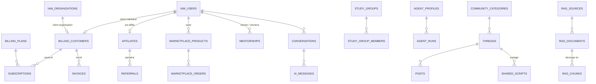

# 02 — Base de données

Source de vérité : [`db/migrations/001_initial_schema.sql`](../db/migrations/001_initial_schema.sql) (PostgreSQL 16, **96 tables/vues**, testé). Données de démonstration : [`db/seeds/001_demo.sql`](../db/seeds/001_demo.sql) (rejouable sans doublon).

## Principes

| Principe | Pourquoi |
|---|---|
| **Un schéma par bounded context** (`iam`, `learning`, `kb`, `diagnostic`, `labs`, `assessment`, `gamification`, `community`, `billing`, `ai`, `notification`, `skills`, `platform`) | Rend visibles les frontières DDD et permet d'extraire un contexte vers sa propre base sans réécriture. |
| Clés étrangères **uniquement à l'intérieur d'un schéma**, plus vers `iam.users` | `iam.users.id` est l'identité stable partagée. Les autres liens inter-contextes sont des références logiques (ex. `learning.lessons.lab_template_id`). |
| UUID v4 partout (`gen_random_uuid()`) | Génération côté client possible, pas de fuite de volumétrie, fusion de bases facilitée. |
| Tables **append-only partitionnées** pour les gros volumes : `platform.audit_log`, `gamification.xp_ledger`, `ai.messages` | Purge par partition (rétention RGPD), index plus petits. Une partition `DEFAULT` existe ; les partitions mensuelles seront créées par `pg_partman` (Phase 2). |
| **Outbox** (`platform.outbox_events`) + idempotence (`platform.processed_events`) | Garantit qu'aucun événement n'est perdu ni traité deux fois (voir architecture §6). |
| Read models CQRS : `learning.dashboard_progress` (vue matérialisée), `gamification.leaderboard` (vue) | Lectures rapides du tableau de bord ; Redis prendra le relais pour le classement à grande échelle. |
| `CHECK` et `ENUM` pour les invariants simples | La base refuse les données incohérentes même si un bug applicatif les envoie. |
| Contenu pédagogique **obligatoire** dans le modèle | `kb.command_examples.explanation`, `community.shared_scripts.explanation`, `assessment.questions.explanation` sont `NOT NULL` : la philosophie « comprendre avant d'exécuter » est inscrite dans le schéma. |

## Diagramme entité-relation (contextes cœur)

```mermaid
erDiagram
  IAM_USERS ||--o{ IAM_EXTERNAL_IDENTITIES : "se connecte via"
  IAM_USERS ||--o{ IAM_PASSKEYS : possede
  IAM_USERS ||--o{ IAM_MFA_FACTORS : possede
  IAM_USERS ||--o{ IAM_USER_ROLES : a
  IAM_ROLES ||--o{ IAM_ROLE_PERMISSIONS : accorde
  IAM_ORGANIZATIONS ||--o{ IAM_MEMBERSHIPS : regroupe
  IAM_USERS ||--o{ IAM_MEMBERSHIPS : "appartient a"
  IAM_USERS ||--o{ IAM_ENTITLEMENTS : "droits"

  LEARNING_PATHS ||--o{ PATH_COURSES : contient
  COURSES ||--o{ PATH_COURSES : "fait partie de"
  COURSES ||--o{ MODULES : contient
  MODULES ||--o{ LESSONS : contient
  LESSONS }o--o{ SKILLS : developpe
  IAM_USERS ||--o{ ENROLLMENTS : "s'inscrit"
  LEARNING_PATHS ||--o{ ENROLLMENTS : ""
  IAM_USERS ||--o{ LESSON_PROGRESS : progresse

  KB_COMMANDS ||--o{ COMMAND_PARAMETERS : a
  KB_COMMANDS ||--o{ COMMAND_EXAMPLES : illustre
  KB_COMMANDS }o--o{ KB_COMMANDS : "alternative a"
  KB_COMMANDS }o--o{ KB_SOURCES : cite

  DIAG_SYMPTOMS ||--o{ DIAG_RULES : ""
  DIAG_CAUSES ||--o{ DIAG_RULES : "P(symptome|cause)"
  DIAG_CAUSES ||--o{ EVIDENCE_PATTERNS : "renforcee par"
  IAM_USERS ||--o{ DIAG_SESSIONS : lance
  DIAG_SESSIONS ||--o{ SESSION_SYMPTOMS : observe
  DIAG_SESSIONS ||--o{ DIAG_ATTACHMENTS : joint
  DIAG_SESSIONS ||--o{ HYPOTHESES : produit

  LAB_TEMPLATES ||--o{ FAULT_SCENARIOS : injecte
  LAB_TEMPLATES ||--o{ VALIDATORS : verifie
  LAB_TEMPLATES ||--o{ LAB_INSTANCES : instancie
  IAM_USERS ||--o{ LAB_INSTANCES : pratique

  QUIZZES ||--o{ QUIZ_QUESTIONS : ""
  QUESTIONS ||--o{ QUIZ_QUESTIONS : ""
  IAM_USERS ||--o{ ATTEMPTS : tente
  CERTIFICATIONS ||--o{ CERTIFICATES : delivre
  IAM_USERS ||--o{ CERTIFICATES : obtient

  IAM_USERS ||--o{ XP_LEDGER : gagne
  IAM_USERS ||--|| USER_STATS : ""
  BADGES ||--o{ USER_BADGES : ""
```





## Inventaire par schéma

| Schéma | Tables |
|---|---|
| `platform` | outbox_events, processed_events, audit_log (partitionnée) |
| `iam` | users, external_identities, mfa_factors, passkeys, sessions, roles, permissions, role_permissions, user_roles, organizations, memberships, entitlements |
| `skills` | skills, prerequisites, user_skill_scores |
| `learning` | careers, learning_paths, courses, path_courses, modules, lessons, lesson_skills, enrollments, lesson_progress, user_goals, dashboard_progress (vue matérialisée) |
| `kb` | commands (recherche plein texte + trigrammes), command_parameters, command_examples, command_alternatives, concepts, sources, command_sources, command_links |
| `editorial` | revisions (une par modification de contenu : fiche, cours, parcours ou cause ; une seule ouverte par cible), revision_events |
| `diagnostic` | symptoms, causes, rules, evidence_patterns, reference_cases (cas rejoués avant publication d'une cause), sessions, session_symptoms, attachments, hypotheses, probe_devices |
| `labs` | lab_templates (runtime `simulation` : machine en panne et validateurs dans `simulation`, migration 011), fault_scenarios et validators (réservés aux runtimes réels), instances (état courant de la machine, historique des commandes, indices utilisés ; une seule session ouverte par apprenant et par lab) |
| `assessment` | questions (`generated_by_ai`, `reviewed` toujours vrai à la publication), question_skills, quizzes (publiés depuis le back-office, liés à leur fiche par `kb.command_links` — migration 010), quiz_questions, attempts (une ligne par tentative d'un apprenant connecté : réponses, score, réussite), certifications, certificates |
| `gamification` | xp_ledger (partitionnée), user_stats, levels, badges, user_badges, challenges, challenge_participants, leaderboard (vue) |
| `community` | categories, threads, posts, votes, shared_scripts, reports, study_groups, study_group_members, mentorships |
| `billing` | plans, customers, subscriptions, invoices, coupons, affiliates, referrals, marketplace_products, marketplace_orders, stripe_webhook_events |
| `ai` | agent_profiles (missions et domaines de l'assistant, modifiables dans le back-office, version incrémentée à chaque publication — migration 009), conversations, messages (partitionnée), agent_runs (un appel au modèle : utilisateur, agent, modèle, latence, jetons dont cache — base du quota et du suivi des coûts, migration 008), feedback, rag_sources, rag_documents, rag_chunks |
| `notification` | notifications, preferences |

## Points d'attention

- **Vérification des certificats** : `assessment.certificates.serial` est public (encodé dans le QR code), `signature` (Ed25519) permet une vérification hors ligne. La page `/verify/<serial>` affiche titulaire, certification, date, statut (valide, expiré, révoqué).
- **Moteur de déduction** : `diagnostic.rules.likelihood` = P(symptôme | cause), `diagnostic.causes.prior` = P(cause). Les règles sont versionnées et relues (`reviewed_by`). Le retour utilisateur (`sessions.resolved_cause_code`) servira à recalibrer les probabilités en Phase 4.
- **Pièces jointes de diagnostic** : expiration par défaut à 30 jours (`expires_at`), hachage SHA-256 pour la déduplication, indicateur de masquage des données personnelles.
- **Échelle** : au-delà de quelques dizaines de millions de lignes, `ai.messages` et `gamification.xp_ledger` passent en partitions mensuelles ; `community` et `kb` sont indexés dans Elasticsearch pour la recherche ; la base peut être shardée par `user_id` avec Citus.

## Commandes utiles

```bash
pnpm db:migrate   # applique db/migrations/*.sql dans l'ordre (table platform.schema_migrations)
pnpm db:seed      # charge les données de démonstration
pnpm db:reset     # supprime et recrée (développement uniquement)
```
