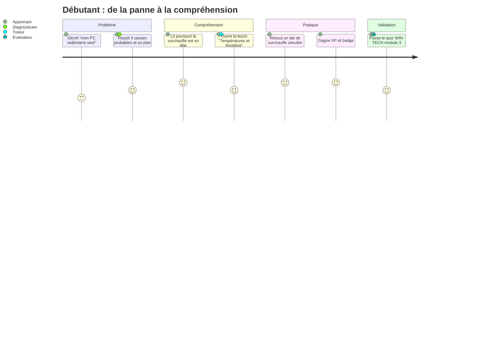
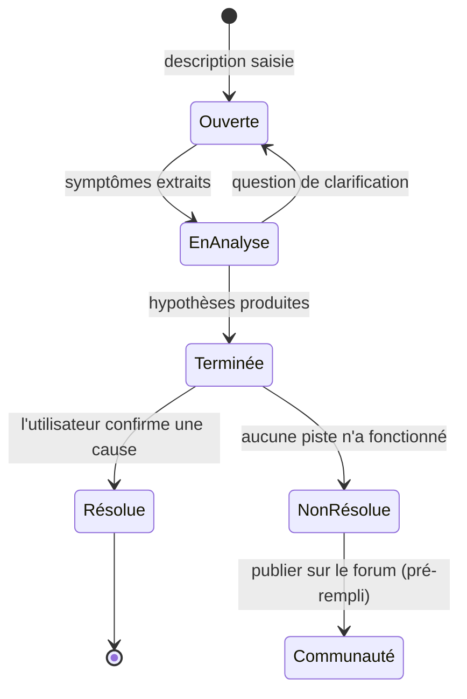

# 03 — Spécifications fonctionnelles

Chaque fonctionnalité est décrite par : objectif, acteurs, règles métier, critères d'acceptation. La colonne **Phase** renvoie à la [feuille de route](05-feuille-de-route.md).

## 0. Principe transversal : « comprendre avant d'exécuter »

Règle qui s'applique à **toutes** les fonctionnalités affichant une commande, un script ou une action corrective :

| ID | Règle |
|---|---|
| P-1 | Toute commande affichée est accompagnée de : **pourquoi**, **comment**, **quand**, **contexte**, **risques**, **alternatives**. Le composant UI `CommandCard` refuse de s'afficher sans ces champs. |
| P-2 | Les commandes de risque `high` ou `critical` sont masquées par défaut ; l'utilisateur doit déplier les risques avant de voir la commande complète. Aucun bouton « copier » sur `critical`. |
| P-3 | En mode apprentissage, une commande `high`/`critical` peut exiger une question de compréhension réussie avant affichage. |
| P-4 | Toute réponse IA cite ses sources ; sans source, elle est étiquetée « non vérifiée ». |
| P-5 | Les scripts partagés dans la communauté doivent contenir une explication et un niveau de risque ; ils sont relus avant d'être mis en avant. |

## 1. Personas

| Persona | Besoin principal |
|---|---|
| **Débutant complet** (reconversion, lycéen) | Un parcours guidé, sans jargon, avec de la pratique sans risque |
| **Technicien en poste** | Résoudre une panne vite *et* comprendre pour la prochaine fois |
| **Administrateur / ingénieur** | Approfondir, se certifier, pratiquer des scénarios avancés |
| **Formateur / école** | Gérer des cohortes, suivre la progression, créer du contenu |
| **Entreprise** | Monter en compétence ses équipes, diagnostic assisté pour le support |
| **Auteur / vendeur** | Publier et vendre des labs et cours sur la marketplace |

## 2. Modules

### 2.1 Comptes et accès (IAM) — Phase 2

- Inscription par e-mail (vérification obligatoire), Google, Microsoft, GitHub, Apple.
- 2FA TOTP, codes de secours, **passkeys** (WebAuthn) comme méthode principale possible.
- Organisations : invitation par e-mail ou domaine, SSO SAML/OIDC (Entreprise et licences).
- Rôles globaux et rôles d'organisation (voir architecture §11).
- RGPD : export complet des données (JSON + fichiers), suppression du compte sous 30 jours.

**Critères** : un utilisateur peut se connecter avec un passkey seul ; un admin d'organisation ne voit jamais les conversations IA privées de ses membres, seulement la progression.

### 2.2 Académie (Learning) — Phase 2

- 6 carrières cibles : technicien, administrateur système, ingénieur systèmes, cloud, cybersécurité, DevOps.
- Parcours → cours → modules → leçons (lecture, vidéo, interactif, lab, quiz, étude de cas).
- Progression **progressive** : une leçon peut exiger des compétences préalables (graphe `skills.prerequisites`). Un test de positionnement permet de sauter ce qui est déjà maîtrisé.
- Recommandations : après un diagnostic, un quiz raté ou un lab échoué, la plateforme propose les leçons qui comblent la lacune.

**Critères** : un débutant qui termine le parcours technicien a validé toutes les compétences du référentiel WIN-TECH.

### 2.3 Base de connaissances — **Phase 1 (lecture)**, Phase 2 (édition)

Chaque fiche commande contient : nom, utilité, historique, fonctionnement interne, architecture interne, syntaxe, paramètres (avec risque par paramètre), exemples expliqués, cas réels, erreurs fréquentes (erreur → cause → correction), bonnes pratiques, alternatives (et quand les préférer), risques, niveau technique, droits requis, sources, quiz et TP liés.

- Recherche plein texte et tolérante aux fautes (`pg_trgm` puis Elasticsearch).
- Filtres : plateforme, niveau, risque.
- Workflow éditorial : brouillon → relecture technique → publié.

**Critères (Phase 1)** : `/commandes` liste les fiches ; `/commandes/linux-rm-rf` affiche la commande masquée tant que les risques ne sont pas lus.

### 2.4 Diagnostic universel — **Phase 1 (moteur v1)**, Phase 3–4 (IA, logs, agent)

Entrées possibles : description libre, sélection de symptômes, capture d'écran (OCR), fichier de logs, collecte par l'agent `sysmaster-probe`.

Sortie :
1. Liste de causes probables triées, chacune avec **probabilité**, **explication** (pourquoi ce symptôme pointe vers cette cause), **plan d'action** ordonné (étape, pourquoi, risque).
2. **Score de confiance** global (dépend de l'écart entre la 1re et la 2e hypothèse et du nombre de preuves).
3. Questions de clarification proposées pour départager les hypothèses (« Voyez-vous un écran bleu avant le redémarrage ? »).
4. Leçons liées pour comprendre la panne.

Règles :
- Le moteur ne propose jamais une action destructive en première étape.
- L'utilisateur indique à la fin si la piste a résolu le problème (alimente la calibration).

**Critères (Phase 1)** : pour « Mon PC redémarre seul, surtout en jeu, et il chauffe », la surchauffe arrive en tête avec une probabilité affichée et un plan d'action expliqué ; l'ajout de la preuve « Event ID 41 Kernel-Power » fait remonter l'alimentation.

### 2.5 Assistant IA multi-agents — Phase 3

- Chat contextuel (dans une leçon, un lab, un diagnostic ou libre).
- Routage automatique vers le bon expert ; l'utilisateur voit quel expert répond.
- Réponses structurées (P-1) et citées (P-4), en streaming.
- Mode « socratique » en apprentissage : l'assistant pose des questions plutôt que de donner la solution d'un lab.
- Quotas par plan.

### 2.6 Laboratoires virtuels — Phase 4

- Catégories : Windows, Linux, macOS (simulé), Docker, Réseau, Cyber, Cloud, Bases de données.
- Chaque lab : énoncé, objectifs, panne injectée réaliste, indices progressifs (coûtent de l'XP), validation automatique, explication de la solution après réussite.
- Terminal web ; durée de vie limitée ; sauvegarde de l'état non garantie (pédagogique).
- Le Générateur de labs (agent 11) propose des variantes ; un humain valide avant publication.

### 2.7 Évaluation et certifications — Phase 5

- Quiz d'entraînement (illimités, explication de chaque réponse) et examens (chronométrés, banque tirée au sort).
- 10 certifications : Windows Technician, Windows Administrator, Linux Administrator, Linux Server Expert, Network Specialist, DevOps Specialist, Docker Specialist, PostgreSQL Specialist, Cybersecurity Specialist, SysMaster Expert.
- Une certification = examen théorique + labs pratiques obligatoires + prérequis éventuels.
- Certificat PDF avec **QR code** vers `/verify/<serial>` ; signature numérique ; révocation possible ; partage LinkedIn.
- Intégrité : surveillance légère (changement d'onglet, copier-coller), questions randomisées.

### 2.8 Gamification — Phase 2

XP (leçons, labs, diagnostics clos, aide en communauté), niveaux (Curieux → Maître système), badges (dont « Lire avant d'exécuter »), séries quotidiennes, défis hebdomadaires, classements (global, amis, organisation). **Règle** : l'XP ne récompense jamais la vitesse de copie ; un lab résolu sans indice rapporte plus.

### 2.9 Communauté — Phase 5

Forum par catégorie, Q&R avec réponse acceptée, partage de labs et de scripts (P-5), mentorat (mise en relation mentor/apprenant), groupes d'étude, modération (signalements, rôles), suggestion IA de questions similaires avant publication.

### 2.10 Tableaux de bord — Phase 2

Apprenant : progression par parcours, carte des compétences (radar), points forts / faibles, recommandations IA, objectifs personnalisés, historique de diagnostics.
Organisation : progression des membres, compétences de l'équipe, rapports exportables.

### 2.11 Paiement et marketplace — Phase 5

| Offre | Prix | Contenu principal |
|---|---|---|
| Free | 0 € | 10 questions IA/jour, 3 diagnostics/mois, labs Linux 2 h/mois |
| Premium | 9,99 €/mois | 100 questions/jour, 30 diagnostics, labs Linux/Docker/Réseau 20 h, −20 % certifications |
| Pro | 19,99 €/mois | IA illimitée (usage raisonnable), tous les labs 60 h, agent de collecte (5 machines), −40 % certifications |
| Entreprise | sur devis | SSO, tableau de bord d'équipe, machines illimitées |
| Centre de formation / École / Université | licence annuelle par siège | cohortes, parcours personnalisés, LTI (université) |

Coupons, codes promo, essai gratuit, facturation (TVA via Stripe Tax), affiliation (commission par défaut 20 %), marketplace (part auteur 70 % par défaut, versement via Stripe Connect).

### 2.12 Applications — Phase 6

Web (Phase 1), puis Android, iOS, iPadOS (React Native + Expo, logique partagée), macOS et Windows (Tauri, réutilise l'app web + agent de collecte intégré).

### 2.13 Back-office — Phase 2+

Gestion des contenus, règles de diagnostic (avec simulation avant publication), sources RAG, modération, utilisateurs, organisations, remboursements, tableaux de bord métier.

## 3. Parcours utilisateur clés

## 4. UX/UI : principes (maquettes détaillées en Phase 2)

- **Design system** : shadcn/ui + Tailwind, thème clair/sombre, typographie lisible pour du code (police monospace dédiée).
- **Hiérarchie de l'information** : la compréhension avant l'action. Dans une `CommandCard`, l'ordre visuel est : *Pourquoi → Quand → Risques → Commande → Alternatives*.
- Code couleur du risque constant partout (aucun / faible / moyen / élevé / critique), toujours doublé d'un libellé texte (accessibilité).
- Animations Framer Motion sobres (transitions, retours de réussite), désactivées si `prefers-reduced-motion`.
- Mobile d'abord pour la lecture et le diagnostic ; labs optimisés pour écran large.
- Internationalisation dès le départ (fr, en en priorité ; es, de, ar, pt ensuite ; support RTL).

Écrans livrés en Phase 1 : accueil, parcours, liste et fiche de commande, diagnostic.
