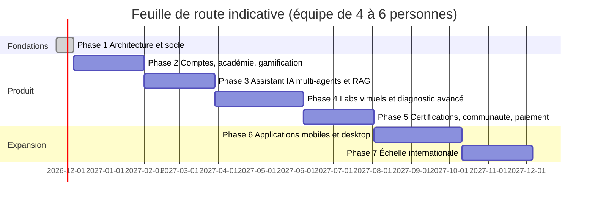

# 05 — Feuille de route

La demande décrit un produit qui, dans les entreprises comparables, représente plusieurs années de travail d'équipe. Elle est découpée en **7 phases**, chacune livrable et utilisable seule. L'ordre suit une logique simple : **d'abord ce qui crée de la valeur pédagogique et différencie le produit (connaissance + diagnostic expliqué), ensuite ce qui coûte cher à opérer (IA générative, labs, mobile)**.

Les durées sont indicatives et supposent une équipe dédiée ; avec un développeur seul assisté par IA, compter environ le double.

## Phase 1 — Architecture et socle ✅ (ce livrable)

| Livrable | Statut | Emplacement |
|---|---|---|
| 1. Architecture complète | ✅ | `docs/01-architecture.md` |
| 2. Base de données complète | ✅ (schéma intégral, testé) | `db/migrations/001_initial_schema.sql`, `docs/02-base-de-donnees.md` |
| 3. Schéma UML | ✅ classes, cas d'utilisation, états | `docs/01`, `docs/03` |
| 4. Diagrammes Mermaid | ✅ | tous les documents |
| 5. Spécifications fonctionnelles | ✅ | `docs/03-specifications-fonctionnelles.md` |
| 6. Spécifications techniques | ✅ | `docs/04-specifications-techniques.md` |
| 7. UX/UI | 🟡 principes + 5 écrans | `docs/03` §4, `apps/web` |
| 8. Code source | 🟡 socle : KB en lecture, moteur de déduction v1, parcours | `apps/` |
| 9. Docker Compose | ✅ Postgres, Redis, Qdrant, API, Web | `docker-compose.yml` |
| 10. Pipeline CI/CD | ✅ CI (lint, typecheck, tests, build, migrations, chart Helm) ; CD : images GHCR par commit et déploiement de test | `.github/workflows/ci.yml`, `cd.yml` |
| 11. Documentation | ✅ pour ce périmètre | `docs/`, `README.md` |
| 12. Scripts de déploiement | 🟡 migration et seed | `infra/scripts/` |
| 13. Fichiers d'installation | 🟡 installation développeur | `README.md` |
| 14. Données de démonstration | ✅ minimales | `db/seeds/001_demo.sql` |
| 15. Guide administrateur | ✅ v1 (Phase 2) | `docs/08-guide-administrateur.md` |
| 16. Guide utilisateur | ✅ v1 (Phase 2) | `docs/07-guide-utilisateur.md` |

## Phase 2 — Comptes, académie, gamification

- ✅ Keycloak : e-mail, Google, Microsoft, GitHub (Apple via extension), 2FA, passkeys ; rôles synchronisés, garde API « fermé par défaut », page Mon compte ([06-authentification.md](06-authentification.md)). Organisations et SSO SAML : avec les licences (Phase 5).
- ✅ Académie : parcours, cours, leçons (24 leçons rédigées), inscription, validation dans l'ordre, progression. ⏳ Test de positionnement et recommandations.
- ✅ Back-office éditorial des fiches commandes : révisions, brouillon → relecture → publication, règle P-1 vérifiée avant soumission, quatre yeux, audit et événement `kb.command.published.v1`. ✅ Même circuit pour les cours (leçons, modules, compétences ; progression des apprenants conservée), les parcours et les causes de diagnostic (règles, motifs, plan d'action), avec simulation sur des cas de référence avant publication.
- ✅ Relais outbox (lots, idempotence, reprise avec attente exponentielle, lettre morte) ; gamification (XP, niveaux, badges, séries, classement avec retrait possible). ⏳ Bus NATS avec le service IA (Phase 3, ADR-013) ; classement en cache Redis si le volume l'exige.
- ✅ Tableau de bord apprenant (niveau, série, badges, compétences, points forts et faibles, recommandations). ⏳ Tableau de bord d'organisation (avec les organisations, Phase 5).
- ✅ Décisions documentées (ADR-012 à 014) : recherche PostgreSQL rendue insensible aux accents (OpenSearch reporté à des seuils mesurables), NATS avec le service IA en Phase 3, pas de BFF GraphQL avant l'application mobile.
- Maquettes UX/UI complètes (Figma) et design system documenté.
- ✅ CD vers l'environnement de test (images GHCR versionnées par commit, chart Helm, migrations avant déploiement, annulation automatique, test de fumée) ; observabilité de base (journaux JSON, identifiant de requête, métriques Prometheus, alertes). ⏳ Cluster de test à fournir (voir docs/08 §7) ; traces OpenTelemetry en Phase 3.
- 🟡 **Contenu** : parcours « Administrateur Linux » (ligne de commande, systemd, réseau, stockage) et « Technicien informatique » (fondamentaux, réseau, disques et démarrage) complets, soit 24 leçons ; 28 fiches commandes sur les 150 visées. Le contenu initial est rédigé dans `db/content/` (seed généré), puis il évolue dans le back-office avec relecture.
- ✅ Guides utilisateur et administrateur v1.

## Phase 3 — Assistant IA multi-agents et RAG

- ✅ Socle de l'assistant : `services/ai` (FastAPI) avec routeur tuteur / diagnosticien et domaines, profils d'agents, sortie structurée validée, garde-fous (risque relevé par motifs destructifs, citations limitées aux documents fournis, réponse « non vérifiée » sans source), mode factice sans clé ; module API (quota sur 24 h, conversations, historique, avis) ; page `/assistant` (commande masquée tant que les risques ne sont pas lus, copie interdite si critique) ; image, Helm (service interne, `NetworkPolicy`), CI Python. ✅ Profils (missions et domaines) modifiables dans le back-office, réservés aux administrateurs, lus par le service IA avec un cache d'une minute ; le socle de sécurité reste dans le code. ✅ Streaming (texte au fil de l'eau, étapes et commandes après les garde-fous). ⏳ Outils et filtres RAG par profil.
- ✅ Pipeline RAG : fiches SysMaster lues en direct par l'API cœur, plus documentation officielle (Microsoft Learn, Ubuntu Server, PostgreSQL, Kubernetes, Docker) collectée dans le respect des licences et de `robots.txt`, indexée dans Qdrant (vecteurs denses multilingues locaux + vecteurs creux), recherche hybride filtrée par plateforme, citations avec attribution. ⏳ Reranking, selon ce que montrera l'évaluation.
- ⏸ NATS JetStream (ADR-013, mis à jour) : pas encore nécessaire, les fiches étant lues en direct par le service IA ; il arrivera avec le premier consommateur hors processus réel.
- ✅ Diagnostic : repérage des symptômes par LLM dans la description et le journal (catalogue fermé, citations vérifiées, le moteur bayésien décide), lignes de journal significatives expliquées, repli sur les synonymes. ⏳ Analyse de captures d'écran (OCR + vision).
- ✅ Suivi des coûts : chaque appel au modèle est tracé par utilisateur avec ses jetons (cache compris) ; quota quotidien commun à toutes les fonctions IA. ⏳ Quotas par forfait (avec la monétisation, Phase 5).
- ✅ Génération de quiz relue avant publication : brouillon rédigé par l'IA depuis une fiche publiée (forme vérifiée par le service, quota commun), corrigé par l'auteur, relu par une autre personne, publié et lié à la fiche. ✅ Passage des quiz par les apprenants depuis la fiche (`/quiz/:slug`) : réponses révélées seulement après la tentative, correction expliquée question par question, tentative enregistrée si l'apprenant est connecté. ⏳ Exercices.
- ✅ Évaluation continue : jeux de référence (assistant, extraction), contrôles déterministes en CI, évaluation avec le vrai modèle et juge par modèle via un workflow manuel.

## Phase 4 — Labs virtuels et diagnostic avancé

**En cours.** ✅ Premier incrément : labs simulés (machine Linux en JSON, commandes interprétées par le domaine, aucune exécution réelle), terminal web `/labs/:slug`, indices qui coûtent des points, validation sur l'état final, solution après réussite, XP et badges. Labs « disque plein » et « port 80 occupé ». ✅ Rédaction des labs dans le back-office, relue, avec démarche de référence rejouée avant publication. ✅ Labs réseau simulés (interfaces, routes, DNS, `ping`, `ip`, `dig`, `curl`, écriture de fichiers avec `echo >` et `sed -i`) : « DNS après migration » et « route par défaut absente ». ✅ Labs Docker simulés (conteneurs, journaux, politiques de redémarrage, fichier compose lu et appliqué par `docker compose up -d`) : « variable renommée après mise à jour » et « port déjà alloué ». ✅ Labs Cyber simulés (droits Unix avec `ls -l`, `chmod`, `chown`, `stat` ; pare-feu `ufw` ordonné ; filtres `grep`, `cut`, `sort`, `uniq -c`, `wc -l` pour lire les journaux) : « force brute sur SSH » et « secrets lisibles par tous ». ✅ Générateur de labs (agent 11) : brouillon complet proposé par l'IA, démarche rejouée sur le simulateur avec une passe de correction, puis relecture humaine. ⏳ Runtimes réels isolés.

- Orchestrateur de labs (Kubernetes + Kata/Firecracker), terminal web, injection de pannes, validateurs.
- Labs Linux, Docker, Réseau, Cyber en premier ; Windows (pool de VM) ensuite ; macOS/iOS en simulation.
- Agent de collecte `sysmaster-probe` (Windows, Linux, macOS), signé, en lecture seule.
- Calibration du moteur de déduction à partir des retours utilisateurs.
- Générateur de labs (agent 11) avec validation humaine.

## Phase 5 — Certifications, communauté, monétisation

- ✅ Examens tirés au sort dans la banque relue, chronométrés, intégrité légère ; certificats signés (Ed25519), imprimables avec QR code, page publique `/verify/<numéro>`, révocation. Les dix examens sont ouverts (banques relues, propositions mélangées, niveaux tirés par certification ; SysMaster Expert tire les questions avancées et expertes de Windows, Linux et réseau). ✅ Paiement des examens (Stripe, remise de l'offre), fermé sans clé. ⏳ PDF généré côté serveur.
- ✅ Forum par catégorie, questions-réponses avec réponse acceptée (XP d'entraide), votes, recherche sans accents, questions similaires avant publication, signalements, masquage automatique, file de modération, verrouillage. ✅ Mentorat (profils, demandes, échanges privés) et groupes d'étude (publics ou sur invitation). ✅ Partage de scripts (explication et risque obligatoires, risque relevé automatiquement, relecture) et de démarches de lab (visibles une fois le lab résolu). ⏳ Notifications.
- ✅ Stripe, abonnements Free/Premium/Pro : page `/tarifs`, paiement par Stripe Checkout, portail client, webhooks signés et idempotents, factures dans `/abonnement`, quota IA selon l'offre, TVA par Stripe Tax en option. Fermé tant que les clés ne sont pas fournies. ✅ Paiement des examens avec remise. ⏳ Licences Entreprise/Centre/École/Université, coupons propres, affiliation, marketplace (Stripe Connect).

## Phase 6 — Applications

- Mobile Android, iOS, iPadOS (React Native + Expo) : académie, diagnostic, assistant, hors ligne partiel.
- Desktop macOS et Windows (Tauri) intégrant l'agent de collecte.
- Notifications push.

## Phase 7 — Échelle internationale

- Multi-région, résidence des données UE, CDN, tests de charge (objectif 50 000 simultanés), Citus si nécessaire.
- Internationalisation (en, es, de, ar avec RTL, pt), contenu traduit et relu.
- Terraform pour toute l'infrastructure, scripts de déploiement production, plan de reprise d'activité.
- Conformité : ✅ RGPD (export, effacement après 7 jours de grâce, durées de conservation appliquées, politique de confidentialité) ; accessibilité WCAG 2.2 AA, audit de sécurité externe, SOC 2 si clientèle entreprise.

## Risques principaux

| Risque | Impact | Atténuation |
|---|---|---|
| Coût des labs (VM Windows surtout) | Élevé | Pool pré-chauffé, quotas, labs Windows réservés aux plans payants |
| Coût et qualité de l'IA | Élevé | Moteur de déduction déterministe, cache, modèles plus petits pour les tâches simples, évaluation continue |
| Licences des documentations (Apple notamment) | Moyen | Citations courtes + liens, pas de republication ; vérification par source |
| Virtualisation macOS/iOS impossible à grande échelle | Moyen | Labs simulés (ADR-010) |
| Volume de contenu pédagogique à produire | Élevé | Outils auteurs + génération IA relue par des experts + marketplace |
| Réponses IA dangereuses (commande destructive) | Critique | Principe P-1/P-2, validateur de sortie, masquage des commandes critiques |
