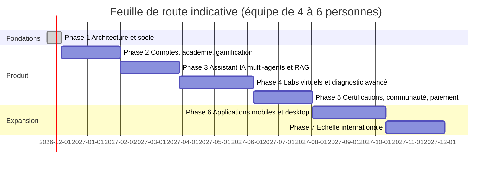

# 05 — Feuille de route

La demande décrit un produit qui, dans les entreprises comparables, représente plusieurs années de travail d'équipe. Elle est découpée en **7 phases**, chacune livrable et utilisable seule. L'ordre suit une logique simple : **d'abord ce qui crée de la valeur pédagogique et différencie le produit (connaissance + diagnostic expliqué), ensuite ce qui coûte cher à opérer (IA générative, labs, mobile)**.

Les durées sont indicatives et supposent une équipe dédiée ; avec un développeur seul assisté par IA, compter environ le double.

## Phase 1 — Architecture et socle ✅ (ce livrable)

| Livrable | Statut | Emplacement |
|---|---|---|
| 1. Architecture complète | ✅ | `docs/01-architecture.md` |
| 2. Base de données complète | ✅ (schéma intégral, testé) | `db/migrations/001_initial_schema.sql`, `docs/02-base-de-donnees.md` |
| 3. Schéma UML | ✅ classes, cas d'utilisation, états | `docs/01`, `docs/03` |
| 4. Diagrammes Mermaid | ✅ | tous les documents |
| 5. Spécifications fonctionnelles | ✅ | `docs/03-specifications-fonctionnelles.md` |
| 6. Spécifications techniques | ✅ | `docs/04-specifications-techniques.md` |
| 7. UX/UI | 🟡 principes + 5 écrans | `docs/03` §4, `apps/web` |
| 8. Code source | 🟡 socle : KB en lecture, moteur de déduction v1, parcours | `apps/` |
| 9. Docker Compose | ✅ Postgres, Redis, Qdrant, API, Web | `docker-compose.yml` |
| 10. Pipeline CI/CD | 🟡 CI (lint, typecheck, tests, build, migrations) ; CD en Phase 2 | `.github/workflows/ci.yml` |
| 11. Documentation | ✅ pour ce périmètre | `docs/`, `README.md` |
| 12. Scripts de déploiement | 🟡 migration et seed | `infra/scripts/` |
| 13. Fichiers d'installation | 🟡 installation développeur | `README.md` |
| 14. Données de démonstration | ✅ minimales | `db/seeds/001_demo.sql` |
| 15. Guide administrateur | ⏳ Phase 2 | |
| 16. Guide utilisateur | ⏳ Phase 2 | |

## Phase 2 — Comptes, académie, gamification

- Keycloak : e-mail, Google, Microsoft, GitHub, Apple, 2FA, passkeys ; rôles et organisations.
- Académie complète : parcours, leçons, progression, test de positionnement, recommandations simples.
- Éditeur de contenu et workflow de relecture (back-office).
- Bus NATS + relais outbox ; projecteurs CQRS ; gamification (XP, niveaux, badges, séries, classements Redis).
- Tableau de bord apprenant et organisation.
- GraphQL BFF, OpenSearch pour la recherche.
- Maquettes UX/UI complètes (Figma) et design system documenté.
- CD vers staging (Kubernetes + Helm), observabilité OpenTelemetry.
- **Contenu** : parcours technicien Windows et administrateur Linux complets, 150 fiches commandes.
- Guides utilisateur et administrateur v1.

## Phase 3 — Assistant IA multi-agents et RAG

- `services/ai` (FastAPI) : routeur, 12 profils d'agents, garde-fous et validateur de sortie, streaming WebSocket.
- Pipeline RAG : ingestion des 6 sources officielles (dans le respect des licences), recherche hybride, reranking, citations obligatoires.
- Diagnostic : extraction de symptômes par LLM, analyse de captures (OCR + vision), analyse de logs (agent 10 + `evidence_patterns`).
- Génération de quiz et d'exercices (relue avant publication).
- Évaluation continue (golden sets), suivi des coûts, quotas par plan.

## Phase 4 — Labs virtuels et diagnostic avancé

- Orchestrateur de labs (Kubernetes + Kata/Firecracker), terminal web, injection de pannes, validateurs.
- Labs Linux, Docker, Réseau, Cyber en premier ; Windows (pool de VM) ensuite ; macOS/iOS en simulation.
- Agent de collecte `sysmaster-probe` (Windows, Linux, macOS), signé, en lecture seule.
- Calibration du moteur de déduction à partir des retours utilisateurs.
- Générateur de labs (agent 11) avec validation humaine.

## Phase 5 — Certifications, communauté, monétisation

- Examens, banques de questions, intégrité, 10 certifications, PDF signé + QR code + page de vérification.
- Forum, Q&R, partage de labs et scripts, mentorat, groupes d'étude, modération.
- Stripe : abonnements Free/Premium/Pro, licences Entreprise/Centre/École/Université, coupons, factures, TVA, affiliation, marketplace (Stripe Connect).

## Phase 6 — Applications

- Mobile Android, iOS, iPadOS (React Native + Expo) : académie, diagnostic, assistant, hors ligne partiel.
- Desktop macOS et Windows (Tauri) intégrant l'agent de collecte.
- Notifications push.

## Phase 7 — Échelle internationale

- Multi-région, résidence des données UE, CDN, tests de charge (objectif 50 000 simultanés), Citus si nécessaire.
- Internationalisation (en, es, de, ar avec RTL, pt), contenu traduit et relu.
- Terraform pour toute l'infrastructure, scripts de déploiement production, plan de reprise d'activité.
- Conformité : RGPD, accessibilité WCAG 2.2 AA, audit de sécurité externe, SOC 2 si clientèle entreprise.

## Risques principaux

| Risque | Impact | Atténuation |
|---|---|---|
| Coût des labs (VM Windows surtout) | Élevé | Pool pré-chauffé, quotas, labs Windows réservés aux plans payants |
| Coût et qualité de l'IA | Élevé | Moteur de déduction déterministe, cache, modèles plus petits pour les tâches simples, évaluation continue |
| Licences des documentations (Apple notamment) | Moyen | Citations courtes + liens, pas de republication ; vérification par source |
| Virtualisation macOS/iOS impossible à grande échelle | Moyen | Labs simulés (ADR-010) |
| Volume de contenu pédagogique à produire | Élevé | Outils auteurs + génération IA relue par des experts + marketplace |
| Réponses IA dangereuses (commande destructive) | Critique | Principe P-1/P-2, validateur de sortie, masquage des commandes critiques |
