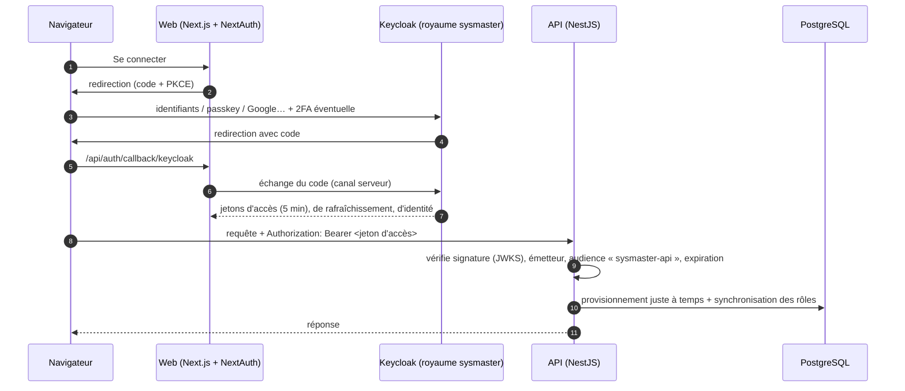

# 06 — Authentification et rôles (guide administrateur)

> Livré en Phase 2 (PR « authentification »). Décision : [ADR-008](01-architecture.md#19-décisions-darchitecture-adr-résumées), Keycloak.

## Principe

**Pourquoi Keycloak plutôt qu'une authentification maison ?** Passkeys (WebAuthn), TOTP, fédération Google/Microsoft/GitHub/Apple, SSO SAML pour les écoles et entreprises, protection contre la force brute, rotation des jetons : ce sont des sujets où une erreur se paie cher. Keycloak est open source, auto-hébergeable (souveraineté pour les licences européennes) et standard (OIDC). **Alternative** : Auth0 ou Clerk (managés, plus simples, mais coût par utilisateur actif élevé à plusieurs millions de comptes). Le code applicatif ne dépend que d'OIDC : changer de fournisseur ne touche que la configuration et l'adaptateur `JoseTokenVerifier`.

## Ce que fait chaque composant

| Composant | Responsabilité | Fichier |
|---|---|---|
| Keycloak | Comptes, mots de passe, 2FA, passkeys, fournisseurs sociaux, rôles | `infra/keycloak/sysmaster-realm.json` |
| Web | Connexion OIDC (code + PKCE), rafraîchissement du jeton, déconnexion fédérée | `apps/web/src/lib/auth.ts` |
| Mobile | Client public `sysmaster-mobile` : code + PKCE S256 dans le navigateur du système, jeton de rafraîchissement dans le trousseau | `apps/mobile/src/lib/auth/` |
| API | Vérification de chaque jeton, garde globale « fermé par défaut », rôles | `apps/api/src/modules/iam/` |
| Base | Profil applicatif (`iam.users.idp_subject`), rôles synchronisés (`iam.user_roles.source = 'idp'`) | `db/migrations/002_iam_oidc.sql` |

## Règles de sécurité appliquées

- **Fermé par défaut** : toute route de l'API exige un jeton, sauf celles marquées `@Public()` (catalogue, base de connaissances) ou `@OptionalAuth()` (diagnostic anonyme possible).
- Un jeton **invalide** est refusé même sur une route publique (401) : on ne masque pas une erreur de sécurité.
- **Audience** obligatoire `sysmaster-api` : un jeton émis pour une autre application du même royaume est refusé.
- **Rôles** : Keycloak fait foi. À chaque connexion, les rôles « idp » sont resynchronisés (un rôle retiré dans Keycloak est retiré dans l'application). Les rôles inconnus sont ignorés. `super_admin` hérite de tous les droits.
- **Liaison de comptes** : un compte existant (import d'école, données de démo) est relié par e-mail **seulement si Keycloak garantit que l'e-mail est vérifié**. Sinon : 403, pour empêcher une prise de contrôle.
- Jeton d'accès de 5 minutes, rafraîchissement rotatif (un jeton de rafraîchissement ne sert qu'une fois), protection force brute, mot de passe de 12 caractères minimum.
- La déconnexion ferme aussi la session Keycloak (déconnexion fédérée), sinon un simple clic sur « Se connecter » reconnecterait sans mot de passe.

## Comptes de démonstration (développement uniquement)

| E-mail | Mot de passe | Rôles |
|---|---|---|
| `admin@sysmaster.local` | `Demo-SysMaster-2026!` | admin |
| `alice@sysmaster.local` | `Demo-SysMaster-2026!` | learner |
| `mentor@sysmaster.local` | `Demo-SysMaster-2026!` | mentor, author, reviewer (rédige et relit les fiches) |

Console Keycloak : http://localhost:8080/admin (`admin` / `admin` par défaut, variables `KC_BOOTSTRAP_ADMIN_*`).

> Si votre volume PostgreSQL date de la Phase 1, la base `keycloak` n'existe pas encore : lancez `docker compose down -v` (efface les données locales) ou `docker compose exec postgres createdb -U sysmaster keycloak`.

## Activer les fournisseurs sociaux

Les fournisseurs sont déclarés **désactivés** dans le royaume. Pour chacun :

1. Créez une application OAuth chez le fournisseur avec l'URL de redirection
   `https://<votre-keycloak>/realms/sysmaster/broker/<alias>/endpoint` (alias : `google`, `microsoft`, `github`).
2. Renseignez `GOOGLE_CLIENT_ID` / `GOOGLE_CLIENT_SECRET` (etc.) dans `.env` **avant le premier import**, ou saisissez-les dans la console : *Identity providers → <alias>*.
3. Activez le fournisseur (*Enabled*). Le bouton apparaît alors sur la page de connexion.

| Fournisseur | Où créer l'application | Remarque |
|---|---|---|
| Google | Google Cloud Console → API et services → Identifiants | Écran de consentement requis |
| Microsoft | Entra ID → Inscriptions d'applications | Comptes personnels et professionnels |
| GitHub | Settings → Developer settings → OAuth Apps | E-mail non garanti vérifié : `trustEmail` est désactivé |
| Apple | Apple Developer → Certificates, IDs & Profiles → Services ID | **Nécessite l'extension** [keycloak-apple-social-identity-provider](https://github.com/klausbetz/apple-identity-provider-keycloak) (fichier JAR dans `/opt/keycloak/providers`). Prévu dans l'image Keycloak de production (Phase 7). |

## Double authentification et passkeys

- **TOTP** : chaque utilisateur peut l'activer dans *Mon compte → Gérer la sécurité du compte*. Pour l'**imposer** (ex. administrateurs, licences entreprise) : *Authentication → Required actions → Configure OTP* (par utilisateur), ou un flux d'authentification conditionnel par rôle.
- **Passkeys** : activées dans le royaume (`webAuthnPolicyPasswordlessPasskeysEnabled`). L'utilisateur enregistre une passkey dans l'espace sécurité ; elle remplace alors le mot de passe. Exige HTTPS en production (le navigateur refuse WebAuthn sur un domaine non sécurisé, sauf `localhost`).

## Application mobile

L'application (Android, iOS, iPadOS) ne peut garder aucun secret : tout ce qu'elle contient peut être extrait. Elle utilise donc le client **public** `sysmaster-mobile`, avec les règles de la RFC 8252 (OAuth pour les applications natives) :

- connexion dans le **navigateur du système** (ASWebAuthenticationSession sur iOS, Custom Tabs sur Android), jamais dans une vue web de l'application : le mot de passe, la passkey ou la 2FA ne passent jamais par le code de SysMaster ;
- **code d'autorisation + PKCE S256 obligatoire** (Keycloak refuse une demande sans `code_challenge`), paramètre `state` vérifié : un code intercepté par une autre application qui aurait réclamé le schéma `sysmaster://` est inutilisable sans le vérificateur, resté en mémoire ;
- **une seule redirection exacte**, `sysmaster://auth` ; pas de mot de passe direct, pas de flux implicite, pas de compte de service ;
- jeton d'accès de 5 minutes **en mémoire seulement** ; jeton de rafraîchissement dans le **trousseau** (Keychain iOS, Keystore Android, accessible après le premier déverrouillage, jamais sauvegardé ni transféré vers un autre appareil). Il tourne à chaque usage : un seul rafraîchissement à la fois, le nouveau jeton est enregistré avant d'être utilisé ;
- **déconnexion** : appel du point de fin de session Keycloak avec le jeton de rafraîchissement (la session et l'authentification unique sont fermées), puis effacement du trousseau et des contenus hors ligne, même sans réseau ;
- hors développement, l'application refuse de démarrer si l'API, Keycloak ou le site ne sont pas en HTTPS.

Le test `apps/api/test/keycloak.e2e-spec.ts` rejoue ce parcours contre le vrai Keycloak en CI : formulaire de connexion, code, échange avec le vérificateur, jeton accepté par l'API, rotation, fin de session, et refus sans PKCE, avec une autre redirection ou par mot de passe direct.

## Production : à changer impérativement

- Supprimer le client `sysmaster-e2e` (il autorise la connexion par mot de passe direct, utile uniquement aux tests).
- Garder le client `sysmaster-mobile` avec sa seule redirection `sysmaster://auth` (pas de joker).
- Supprimer les comptes de démonstration ; activer `verifyEmail` et configurer le SMTP du royaume.
- Secrets : `KEYCLOAK_CLIENT_SECRET`, `NEXTAUTH_SECRET` (`openssl rand -base64 32`), mot de passe administrateur Keycloak, dans un coffre.
- Keycloak en mode `start` (pas `start-dev`), derrière HTTPS, avec `KC_HOSTNAME=https://auth.<domaine>`.
- `sslRequired` à `all`.
