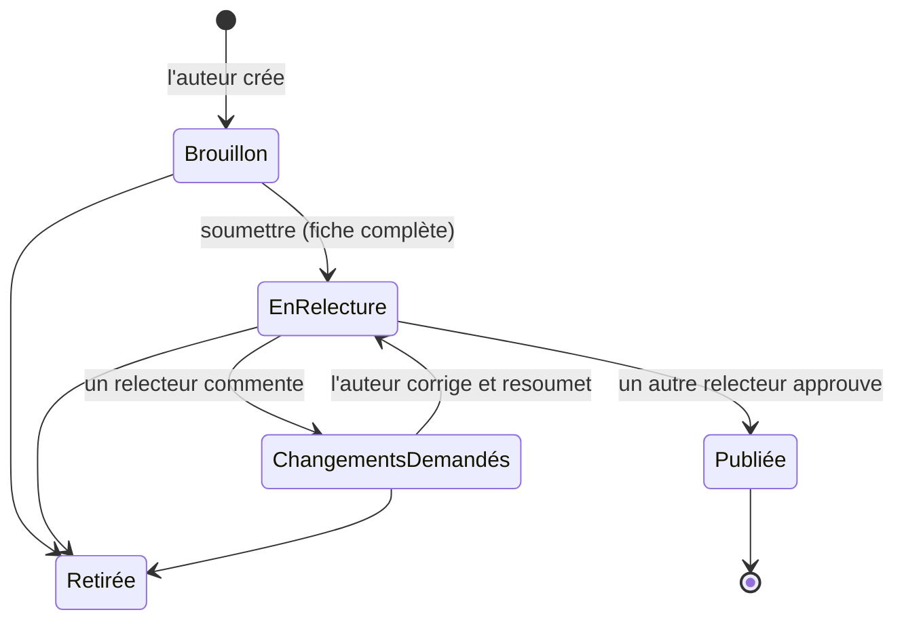

# 08 — Guide administrateur

Ce guide couvre l'exploitation de ce qui est livré : installation, comptes et rôles, contenu, événements, base de données. Comme partout dans SysMaster, chaque opération donne **pourquoi**, **quand**, les **risques** et une **alternative**. L'authentification a son propre guide : [06 — Authentification](06-authentification.md).

## 1. Installer et démarrer

| Besoin | Commande | Remarques |
|---|---|---|
| Tout lancer d'un coup | `cp .env.example .env && docker compose up --build` | Le service `migrate` applique le schéma et les données de démo avant l'API |
| Développer | `docker compose up -d postgres redis qdrant keycloak`, puis `pnpm install`, `pnpm db:migrate && pnpm db:seed` et `pnpm dev` | API sur :4000, web sur :3000 |
| Vérifier que l'API répond | `curl localhost:4000/api/v1/health` | `database: up` confirme la connexion à PostgreSQL |

Les variables d'environnement sont décrites dans [`.env.example`](../.env.example) et dans [04 §9](04-specifications-techniques.md#9-variables-denvironnement). En production, **aucun** des secrets par défaut ne doit rester en place : la liste est dans [06, « Production : à changer impérativement »](06-authentification.md#production--à-changer-impérativement).

## 2. Rôles

Les rôles se donnent dans **Keycloak** (console d'administration → royaume `sysmaster` → Utilisateurs → *Role mapping*). L'API les relit dans le jeton à chaque connexion et les recopie dans `iam.user_roles` : il n'y a rien à faire côté base.

| Rôle | Ce qu'il ouvre aujourd'hui |
|---|---|
| `learner` | Rôle par défaut : académie, diagnostic, tableau de bord |
| `author` | Rédiger des révisions de fiches commandes |
| `reviewer` | Relire et publier les révisions **des autres** |
| `admin` | Tout ce qui précède, plus la liste des utilisateurs (`GET /admin/users`) et le retrait de n'importe quelle révision |
| `support` | Liste des utilisateurs |
| `mentor`, `moderator` | Réservés aux modules communauté (Phase 5) |

- **Pourquoi passer par Keycloak plutôt que par la base ?** Une seule source de vérité. Un rôle ajouté seulement en base serait écrasé à la connexion suivante.
- **Quand le changement s'applique** : au prochain jeton, c'est-à-dire au plus 5 minutes plus tard. Pour un effet immédiat, l'utilisateur se déconnecte puis se reconnecte.
- **Risque** : un rôle inconnu de l'application n'ouvre aucun droit, une faute de frappe est donc sans danger. En revanche, `admin` ouvre la lecture de tous les comptes : à donner avec parcimonie.

## 3. Contenu : le workflow éditorial



Règles garanties par l'API (et pas seulement par l'interface) :

- **Fiche complète avant soumission**. Il faut : pourquoi, quand, contexte, au moins un risque, un exemple expliqué, une alternative publiée et une source. Le niveau de risque de la fiche ne peut pas être inférieur à celui de son risque ou de son paramètre le plus grave. Une fiche à risque élevé ou critique doit décrire au moins une erreur fréquente.
- **Quatre yeux** : personne ne relit sa propre révision, administrateurs compris. La base le vérifie aussi (contrainte `reviewer_id <> author_id`).
- **Une révision ouverte par fiche**, pour que deux modifications ne s'écrasent pas.
- **La version en ligne ne change qu'à l'approbation**. La publication tient en une transaction : la fiche, ses paramètres, exemples, alternatives et sources, le journal d'audit et l'événement `kb.command.published.v1`.

**Grille de relecture conseillée** :

1. La commande fait-elle ce que dit la fiche, sur la plateforme indiquée ?
2. Les risques sont-ils complets ? Pensez aux variables vides, aux droits root et aux données de production.
3. Le niveau de risque est-il juste ? Il pilote le masquage de la commande et la présence du bouton copier.
4. Les sources sont-elles officielles et à jour ?
5. Un débutant comprendrait-il **pourquoi** avant de lire **comment** ?

**Historique d'une fiche** :

```sql
SELECT r.id, r.status, e.action, u.display_name, e.comment, e.created_at
  FROM editorial.revisions r
  JOIN editorial.revision_events e ON e.revision_id = r.id
  JOIN iam.users u ON u.id = e.actor_id
 WHERE r.kind = 'command' AND r.content->>'slug' = 'linux-systemctl'
 ORDER BY e.created_at;
```

Cette requête est en lecture seule et sans risque. Le journal d'audit global est dans `platform.audit_log` (actions `kb.command.published`, `learning.course.published`, etc.).

**Cours, parcours et causes de diagnostic** suivent le même circuit (brouillon, relecture par une autre personne, publication en une transaction), avec leurs propres règles avant soumission :

- **Cours** : chaque leçon a un identifiant d'URL unique, au moins un objectif et un contenu. Une leçon renommée ou déplacée garde sa progression, car elle est reconnue par son identifiant d'URL. **Supprimer une leçon qu'un apprenant a déjà validée est refusé** : masquez-la plutôt dans un module « Archives ». À la publication, la progression des inscrits est recalculée.
- **Parcours** : au moins un cours publié, dans l'ordre conseillé.
- **Causes de diagnostic** : chaque règle « symptôme → cause » est justifiée, chaque étape du plan d'action dit **pourquoi**, et la première étape n'est jamais risquée (on observe avant d'agir). Les motifs de journaux doivent être des expressions régulières valides.

- **Quiz** : chaque question a au moins deux choix, une bonne réponse parmi eux (une seule pour une question à choix unique), pas tous les choix justes, et une explication. Un auteur peut partir d'un **brouillon rédigé par l'IA** (« Brouillon par l'IA depuis la fiche » dans « Contribuer », type Quiz) : les questions proposées portent le badge « Proposée par l'IA » ; vérifiez que la bonne réponse se justifie par la fiche et que les mauvais choix sont plausibles. Le brouillon compte dans le quota IA quotidien de l'auteur. Un quiz publié est lié à sa fiche.
- **Profils d'agents IA** (administrateurs seulement, à la rédaction comme à la relecture) : les consignes de mission (tuteur, diagnosticien) et de domaine (Windows, Linux, conteneurs, réseau) que l'assistant ajoute à son socle de sécurité. Le socle lui-même (comprendre avant d'exécuter, citations, risques) ne se modifie pas ici. Les consignes font au moins une phrase et ne contiennent pas les balises du contexte (`<documents>`, `<question>`…). Publiées, elles s'appliquent en une minute environ ; décocher « Actif » ramène l'assistant aux consignes d'origine. Après une modification, lancez l'évaluation (`services/ai/README.md`, section Évaluation) pour vérifier que les réponses restent justes.

**Simulation avant publication.** Pour une cause, l'éditeur rejoue les cas de référence (`diagnostic.reference_cases`) avec la base actuelle puis avec le brouillon. Une **régression** signifie qu'un cas trouvait la bonne cause en tête et ne la trouve plus. Le relecteur ne peut approuver une régression qu'en expliquant pourquoi dans son commentaire. Pour ajouter un cas de référence (lecture seule pour les apprenants, sans risque) :

```sql
INSERT INTO diagnostic.reference_cases (name, platform, description, symptoms, evidence, expected_cause)
VALUES ('Mon cas', 'windows', 'Description telle qu''un utilisateur l''écrirait', '{}', NULL, 'overheating');
```

Pourquoi : un cas de référence fige un diagnostic qu'on sait juste ; toute modification future des règles sera vérifiée contre lui.

## 4. Événements (outbox)

Chaque changement important écrit un événement dans `platform.outbox_events`, dans la même transaction que la donnée. Le relais intégré à l'API le distribue ensuite aux consommateurs, aujourd'hui la gamification. Le fonctionnement détaillé est dans [01 — Architecture](01-architecture.md).

### Surveiller

```sql
-- En attente (normalement proche de 0 : le relais passe toutes les secondes)
SELECT count(*) FROM platform.outbox_events WHERE published_at IS NULL AND attempts < 10;

-- En échec : retentés avec une attente croissante
SELECT id, type, attempts, last_error, next_attempt_at
  FROM platform.outbox_events WHERE published_at IS NULL AND attempts BETWEEN 1 AND 9;

-- Lettres mortes : abandonnés après 10 essais, à examiner
SELECT id, type, last_error, occurred_at
  FROM platform.outbox_events WHERE published_at IS NULL AND attempts >= 10;
```

**Pourquoi c'est important** : un événement bloqué signifie de l'XP ou des badges non attribués. Rien n'est perdu pour autant, puisque l'événement attend en base.

### Rejouer une lettre morte

D'abord, corrigez la cause indiquée par `last_error`, sinon l'événement échouera de nouveau. Ensuite :

```sql
UPDATE platform.outbox_events
   SET attempts = 0, next_attempt_at = now(), last_error = NULL
 WHERE id = '<id>' AND published_at IS NULL;
```

- **Risque : faible.** Chaque consommateur note dans `platform.processed_events` ce qu'il a déjà traité, donc un consommateur qui avait réussi ne recompte rien. Seuls ceux qui avaient échoué le retraitent.
- **À ne pas faire** : remettre `published_at` à NULL en masse. C'est sans effet sur les consommateurs déjà passés, et cela charge le relais pour rien.
- **Réglage** : `OUTBOX_RELAY_INTERVAL_MS` (1000 par défaut ; 0 désactive le relais, ce qui est utile pour une maintenance).

## 5. Base de données

| Commande | Pourquoi | Risque | Alternative |
|---|---|---|---|
| `pnpm db:migrate` | Applique les migrations SQL pas encore appliquées (suivies dans `platform.schema_migrations`) | Faible : chaque migration tourne en transaction. Faites une sauvegarde avant en production | — |
| `pnpm db:seed` | Charge les données de démo. Rejouable sans doublon | Faible, mais **à ne jamais lancer en production** : comptes et contenus fictifs | Importer du vrai contenu par le back-office |
| `node infra/scripts/build-content-seed.mjs` | Régénère `db/seeds/006_contenu_parcours.sql` après une modification de `db/content/` (fiches et cours initiaux). La CI vérifie qu'il est à jour, et un test applique au contenu les mêmes règles que la relecture | Aucun : écrit un seul fichier. Le seed n'écrase jamais un contenu déjà présent : une fois chargé, un contenu évolue dans le back-office | Modifier le contenu en ligne dans `/editorial` |
| `pnpm db:reset` | Supprime tous les schémas applicatifs puis recrée tout | **Critique** : efface toutes les données, sans corbeille | En développement seulement. Sinon, sauvegardez puis restaurez |
| `pg_dump -Fc -f sysmaster.dump "$DATABASE_URL"` | Sauvegarde complète, compressée | Aucun : lecture seule | Sauvegardes gérées par l'hébergeur (PITR) |
| `pg_restore --clean --if-exists -d "$DATABASE_URL" sysmaster.dump` | Restaurer une sauvegarde | **Élevé** : remplace les données actuelles | Restaurer d'abord dans une base vide pour vérifier |

## 6. Problèmes fréquents

| Symptôme | Cause | Correction |
|---|---|---|
| `403 « Cet e-mail est déjà associé à un autre compte ou n'est pas vérifié »` | Le compte a été recréé dans Keycloak (nouvel identifiant) alors que la base garde le lien vers l'ancien. C'est un refus volontaire : on ne rattache pas un compte existant à une nouvelle identité sans contrôle | Après avoir vérifié qu'il s'agit bien de la même personne : `UPDATE iam.users SET idp_subject = NULL WHERE email = '<e-mail>';` Le lien se refait à la connexion suivante, si l'e-mail est vérifié |
| L'XP n'augmente pas après une leçon validée | Relais désactivé (`OUTBOX_RELAY_INTERVAL_MS=0`) ou événement en échec | Requêtes de la section 4 |
| `401` sur toutes les routes protégées | `OIDC_ISSUER` ne correspond pas à l'émetteur des jetons (souvent `localhost` d'un côté et le nom du conteneur de l'autre) | Voir [06](06-authentification.md) : émetteur public et émetteur interne |
| La soumission d'une fiche renvoie `422` | La fiche ne respecte pas encore la règle P-1 | La réponse liste les manques, et l'éditeur les affiche aussi |

## 7. Déploiement de test (Kubernetes)

**Pourquoi** : vérifier chaque version de `main` dans des conditions proches de la production avant de la proposer aux utilisateurs. **Comment** : la CD (`.github/workflows/cd.yml`) construit les images `ghcr.io/kadtaf/sysmaster-api` et `sysmaster-web`, étiquetées `sha-<commit>`, puis installe le chart `infra/helm/sysmaster`.

Ordre d'un déploiement :

1. un Job applique les migrations (hook Helm `pre-upgrade`). S'il échoue, rien d'autre ne change et l'ancienne version continue de servir ;
2. les pods sont remplacés un par un ; un pod ne reçoit du trafic que si `/health/ready` répond ;
3. si l'ensemble n'est pas prêt en 10 minutes, Helm revient automatiquement à la version précédente (`--atomic`) ;
4. un test de fumée vérifie que `/api/v1/health` annonce bien la nouvelle version.

**Ce qu'il faut fournir une fois** (le chart n'installe ni Postgres ni Keycloak, qui doivent être sauvegardés indépendamment de l'application) :

| Élément | Où | Contenu |
|---|---|---|
| Cluster Kubernetes avec un contrôleur ingress NGINX et cert-manager | votre hébergeur | — |
| Postgres 16 | service géré conseillé | une base vide ; les migrations s'appliquent seules |
| Keycloak | chart Bitnami ou service géré | royaume importé depuis `infra/keycloak/sysmaster-realm.json`, URL de redirection du client web = `https://<hôte>/*` |
| Secret `sysmaster-secrets` dans le namespace `sysmaster-staging` | `kubectl` | `DATABASE_URL`, `NEXTAUTH_SECRET`, `KEYCLOAK_CLIENT_SECRET`, `AI_SERVICE_TOKEN` (et `ANTHROPIC_API_KEY` si `ai.llm=claude`) |
| Secret GitHub `STAGING_KUBECONFIG` | environnement GitHub « staging » | kubeconfig d'un compte limité à ce namespace |
| Variables GitHub `STAGING_HOST`, `STAGING_OIDC_ISSUER` | même environnement | ex. `test.sysmaster.fr`, `https://auth.sysmaster.fr/realms/sysmaster` |

Créer le secret applicatif (risque faible : il n'écrit que dans ce namespace ; ne le collez jamais dans un ticket) :

```bash
kubectl create namespace sysmaster-staging
kubectl -n sysmaster-staging create secret generic sysmaster-secrets \
  --from-literal=DATABASE_URL='postgres://…' \
  --from-literal=NEXTAUTH_SECRET="$(openssl rand -base64 32)" \
  --from-literal=KEYCLOAK_CLIENT_SECRET='…' \
  --from-literal=AI_SERVICE_TOKEN="$(openssl rand -hex 32)"
```

L'assistant tourne en mode factice en test (`values-staging.yaml`, `ai.llm: fake`) : aucune clé, aucun coût. Pour essayer le vrai modèle, ajoutez la clé au secret puis passez `--set ai.llm=claude` :

```bash
# Pourquoi patch et pas create : le secret existe déjà ; on ajoute une clé sans toucher aux autres.
kubectl -n sysmaster-staging patch secret sysmaster-secrets --type merge \
  -p "{\"stringData\":{\"ANTHROPIC_API_KEY\":\"$ANTHROPIC_API_KEY\"}}"
```

Risque : chaque question consomme des jetons facturés. Le quota par utilisateur (`ai.assistantDailyQuota`, 30 par défaut) borne la dépense ; le coût réel se lit dans `ai.agent_runs` (tokens d'entrée, de sortie et de cache par réponse).

**Documentation officielle de l'assistant (facultatif).** Sans Qdrant, l'assistant s'appuie seulement sur les fiches SysMaster. Pour lui donner la documentation officielle :

1. Installer Qdrant (chart officiel `qdrant/qdrant` ou service géré), comme Postgres hors de ce chart.
2. Passer `--set ai.qdrantUrl=http://<qdrant>:6333 --set ai.ingest.enabled=true` : un CronJob collecte les sources de `services/ai/sources.toml` chaque dimanche à 3 h 17.
3. Lancer une première collecte sans attendre :

```bash
# Pourquoi create job --from : exécute tout de suite le même Job que le CronJob, avec les mêmes réglages.
kubectl -n sysmaster-staging create job --from=cronjob/sysmaster-ai-ingest ingest-initial
kubectl -n sysmaster-staging logs -f job/ingest-initial
```

Risque faible : la collecte ne fait que lire des sites publics (une page par seconde, `robots.txt` respecté) et écrire dans Qdrant. Elle exige un accès Internet sortant depuis le cluster. Changer de modèle de plongement (`EMBED_MODEL`) impose de supprimer la collection `official_docs` puis de relancer la collecte : le service le signale clairement au lieu de mélanger deux modèles.

Sans `STAGING_KUBECONFIG`, la CD publie les images et s'arrête là, avec une note dans le résumé du workflow.

**Revenir en arrière** : `helm -n sysmaster-staging rollback sysmaster`. Le code revient, **pas le schéma de la base**. C'est pourquoi chaque migration doit rester compatible avec la version précédente du code : on ajoute une colonne dans une version, on la rend obligatoire dans la suivante.

**Surveiller** (métriques et alertes : voir [04 §10](04-specifications-techniques.md)) :

- `SysmasterOutboxLettreMorte` : suivre « Rejouer une lettre morte » (§4) ;
- `SysmasterApiErreurs5xx` : chercher les lignes `"level":"error"` du contexte `HTTP`, puis suivre le `requestId` ;
- `SysmasterApiIndisponible` : `kubectl -n sysmaster-staging describe pod -l app.kubernetes.io/component=api`. Une sonde ready en échec signifie presque toujours que la base est injoignable.

## 8. Pas encore livré

Ces sujets sont prévus dans la [feuille de route](05-feuille-de-route.md) :

- modération ;
- tableau de bord d'organisation ;
- production (promotion manuelle des images testées, déploiement progressif) et traces OpenTelemetry.
