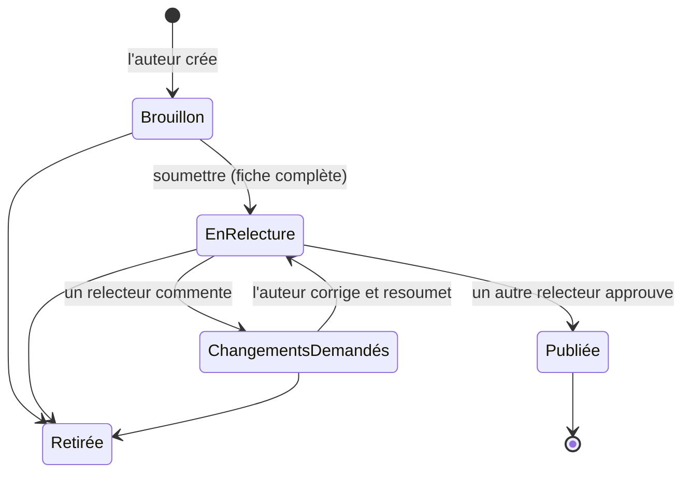

# 08 — Guide administrateur

Ce guide couvre l'exploitation de ce qui est livré : installation, comptes et rôles, contenu, événements, base de données. Comme partout dans SysMaster, chaque opération donne **pourquoi**, **quand**, les **risques** et une **alternative**. L'authentification a son propre guide : [06 — Authentification](06-authentification.md).

## 1. Installer et démarrer

| Besoin | Commande | Remarques |
|---|---|---|
| Tout lancer d'un coup | `cp .env.example .env && docker compose up --build` | Le service `migrate` applique le schéma et les données de démo avant l'API |
| Développer | `docker compose up -d postgres redis qdrant keycloak`, puis `pnpm install`, `pnpm db:migrate && pnpm db:seed` et `pnpm dev` | API sur :4000, web sur :3000 |
| Vérifier que l'API répond | `curl localhost:4000/api/v1/health` | `database: up` confirme la connexion à PostgreSQL |

Les variables d'environnement sont décrites dans [`.env.example`](../.env.example) et dans [04 §9](04-specifications-techniques.md#9-variables-denvironnement). En production, **aucun** des secrets par défaut ne doit rester en place : la liste est dans [06, « Production : à changer impérativement »](06-authentification.md#production--à-changer-impérativement).

### Réglages de sécurité

- **Refus de démarrer** : en production (`NODE_ENV=production`), l'API s'arrête au démarrage si `AI_SERVICE_TOKEN` manque, vaut la valeur de développement ou fait moins de 32 caractères, si `CORS_ORIGINS` est vide ou vaut `*`, ou si `OIDC_ISSUER` manque, ou si une seule des deux clés Stripe est fournie. Le service IA refuse lui aussi le jeton de développement dès que `AI_LLM=claude`. Le message d'erreur nomme la variable à corriger.
- **Limitation de débit** : 600 requêtes par minute et par personne (ou par adresse IP sans connexion), réglable par `RATE_LIMIT_PER_MINUTE` (0 la coupe). Des limites plus serrées protègent les routes coûteuses ou devinables : 20 questions à l'IA par minute (assistant et diagnostic), 10 générations de quiz ou de lab par 5 minutes, 10 examens ouverts par heure, 10 essais de code de groupe par 10 minutes, 5 exports de données personnelles par heure, 30 vérifications de certificat par minute, 10 ouvertures de paiement ou du portail Stripe par 10 minutes. Au-delà : `429` avec `Retry-After`. Le compteur est propre à chaque instance de l'API.
- **Adresse IP derrière un proxy** : `TRUST_PROXY=1` (valeur du chart) fait confiance à l'ingress pour `X-Forwarded-For`. Sans proxy déclaré, cet en-tête est ignoré, sinon n'importe qui choisirait l'adresse qui lui sert de clé.
- **Documentation OpenAPI** (`/api/docs`) : fermée en production, sauf `API_DOCS=true`.
- **En-têtes** : l'API envoie ceux de helmet avec une politique de contenu `default-src 'none'` (elle ne sert que du JSON). Le site interdit les ressources tierces, l'intégration dans un cadre et les formulaires vers d'autres sites (`apps/web/next.config.ts`). Si vous ajoutez un outil externe (mesure d'audience, police distante), il faut l'y déclarer, et la page de confidentialité doit le dire.
- **Données envoyées au modèle** : avant chaque appel, le service IA masque e-mails, mots de passe (`password=…`, chaînes de connexion), jetons et clés d'API, clés privées, numéros de carte, IBAN et téléphones. Les adresses IP, noms d'hôtes et chemins restent, car le diagnostic en a besoin. Le journal du service ne garde que le nombre d'éléments masqués, jamais le texte.
- **Dépendances** : la CI échoue si `pnpm audit --prod` trouve une faille élevée ou critique. Mettez la dépendance à jour, ou, si elle ne sert qu'à la construction, forcez une version corrigée dans `pnpm.overrides` (c'est le cas de `postcss`, tiré par Next.js).

## 2. Rôles

Les rôles se donnent dans **Keycloak** (console d'administration → royaume `sysmaster` → Utilisateurs → *Role mapping*). L'API les relit dans le jeton à chaque connexion et les recopie dans `iam.user_roles` : il n'y a rien à faire côté base.

| Rôle | Ce qu'il ouvre aujourd'hui |
|---|---|
| `learner` | Rôle par défaut : académie, diagnostic, tableau de bord |
| `author` | Rédiger des révisions de fiches commandes |
| `reviewer` | Relire et publier les révisions **des autres** |
| `admin` | Tout ce qui précède, plus la liste des utilisateurs (`GET /admin/users`) et le retrait de n'importe quelle révision |
| `support` | Liste des utilisateurs |
| `moderator` | File de modération de la communauté (`/communaute/moderation`) : masquer, rétablir, écarter les signalements, verrouiller un sujet. Peut répondre dans un sujet verrouillé |
| `mentor` | Publier un profil de mentor (`/communaute/mentorat`) et recevoir des demandes. Retirer le rôle retire le profil de la liste, mais pas les mentorats en cours |

- **Pourquoi passer par Keycloak plutôt que par la base ?** Une seule source de vérité. Un rôle ajouté seulement en base serait écrasé à la connexion suivante.
- **Quand le changement s'applique** : au prochain jeton, c'est-à-dire au plus 5 minutes plus tard. Pour un effet immédiat, l'utilisateur se déconnecte puis se reconnecte.
- **Risque** : un rôle inconnu de l'application n'ouvre aucun droit, une faute de frappe est donc sans danger. En revanche, `admin` ouvre la lecture de tous les comptes : à donner avec parcimonie.

## 3. Contenu : le workflow éditorial



Règles garanties par l'API (et pas seulement par l'interface) :

- **Fiche complète avant soumission**. Il faut : pourquoi, quand, contexte, au moins un risque, un exemple expliqué, une alternative publiée et une source. Le niveau de risque de la fiche ne peut pas être inférieur à celui de son risque ou de son paramètre le plus grave. Une fiche à risque élevé ou critique doit décrire au moins une erreur fréquente.
- **Quatre yeux** : personne ne relit sa propre révision, administrateurs compris. La base le vérifie aussi (contrainte `reviewer_id <> author_id`).
- **Une révision ouverte par fiche**, pour que deux modifications ne s'écrasent pas.
- **La version en ligne ne change qu'à l'approbation**. La publication tient en une transaction : la fiche, ses paramètres, exemples, alternatives et sources, le journal d'audit et l'événement `kb.command.published.v1`.

**Grille de relecture conseillée** :

1. La commande fait-elle ce que dit la fiche, sur la plateforme indiquée ?
2. Les risques sont-ils complets ? Pensez aux variables vides, aux droits root et aux données de production.
3. Le niveau de risque est-il juste ? Il pilote le masquage de la commande et la présence du bouton copier.
4. Les sources sont-elles officielles et à jour ?
5. Un débutant comprendrait-il **pourquoi** avant de lire **comment** ?

**Historique d'une fiche** :

```sql
SELECT r.id, r.status, e.action, u.display_name, e.comment, e.created_at
  FROM editorial.revisions r
  JOIN editorial.revision_events e ON e.revision_id = r.id
  JOIN iam.users u ON u.id = e.actor_id
 WHERE r.kind = 'command' AND r.content->>'slug' = 'linux-systemctl'
 ORDER BY e.created_at;
```

Cette requête est en lecture seule et sans risque. Le journal d'audit global est dans `platform.audit_log` (actions `kb.command.published`, `learning.course.published`, etc.).

**Cours, parcours et causes de diagnostic** suivent le même circuit (brouillon, relecture par une autre personne, publication en une transaction), avec leurs propres règles avant soumission :

- **Cours** : chaque leçon a un identifiant d'URL unique, au moins un objectif et un contenu. Une leçon renommée ou déplacée garde sa progression, car elle est reconnue par son identifiant d'URL. **Supprimer une leçon qu'un apprenant a déjà validée est refusé** : masquez-la plutôt dans un module « Archives ». À la publication, la progression des inscrits est recalculée.
- **Parcours** : au moins un cours publié, dans l'ordre conseillé.
- **Causes de diagnostic** : chaque règle « symptôme → cause » est justifiée, chaque étape du plan d'action dit **pourquoi**, et la première étape n'est jamais risquée (on observe avant d'agir). Les motifs de journaux doivent être des expressions régulières valides.

- **Quiz** : chaque question a au moins deux choix, une bonne réponse parmi eux (une seule pour une question à choix unique), pas tous les choix justes, et une explication. Un auteur peut partir d'un **brouillon rédigé par l'IA** (« Brouillon par l'IA depuis la fiche » dans « Contribuer », type Quiz) : les questions proposées portent le badge « Proposée par l'IA » ; vérifiez que la bonne réponse se justifie par la fiche et que les mauvais choix sont plausibles. Le brouillon compte dans le quota IA quotidien de l'auteur. Un quiz publié est lié à sa fiche.
- **Labs simulés** : énoncé, au moins un objectif et un indice, une solution expliquée, au moins une vérification, et une **démarche de référence** (les commandes qui réparent la machine). À chaque enregistrement, l'éditeur rejoue cette démarche sur la machine de départ : le lab n'est soumis que si toutes les vérifications passent à la fin, si chaque commande est simulée, et si la machine de départ est vraiment en panne (une machine qui passe déjà les vérifications est refusée). La machine se décrit en JSON (répertoires, fichiers et tailles, montages, services, et si besoin `network` : interfaces, routes, et les hôtes du monde simulé avec leurs enregistrements DNS et leur réponse web). La partie `docker` décrit les images (variables obligatoires, port écouté, journal de démarrage, réponse web), les conteneurs et le fichier compose du projet. Les vérifications Docker (`container_running`, `container_autostart`, `http_ok`) et réseau (`host_reachable`, `name_resolves`) et `file_has_line` (une ligne active présente ou absente, pour exiger une correction persistante) complètent celles des services et des disques. Côté Cyber, chaque fichier peut porter `mode` (octal, ex. `"640"`), `owner` et `group` ; un service peut déclarer le compte `user` sous lequel il tourne (il échoue au démarrage s'il ne peut pas lire ses `needsFiles`) ; la partie `firewall` décrit un pare-feu ufw (actif, politique par défaut, règles dans l'ordre). Les vérifications `file_mode_at_most`, `file_readable_by` (l'appartenance aux groupes se lit dans le `/etc/group` de la machine) et `firewall_allows` s'y ajoutent. Grille de relecture : la panne est-elle réaliste ? La solution explique-t-elle ce qu'il ne fallait pas faire ? Les vérifications portent-elles sur le résultat plutôt que sur une méthode ?
- **Brouillon de lab par l'IA** : dans « Contribuer », choisissez le type Lab, décrivez l'incident en une ou deux phrases (ce qui casse, ce que l'apprenant doit comprendre, le raccourci dangereux à éviter), la catégorie et la difficulté. L'IA rédige le lab complet ; la plateforme le passe aux mêmes règles que ceux des auteurs, rejoue la démarche sur le simulateur et, s'il reste un problème, le renvoie une fois à l'IA. Vous arrivez sur une révision ordinaire : les problèmes restants s'y affichent. Relisez surtout la panne (réaliste ?), les vérifications (portent-elles sur le résultat ?) et la solution (explique-t-elle ce qu'il ne fallait pas faire ?). Un brouillon compte pour deux demandes dans le quota IA quand une correction a été nécessaire.
- **Profils d'agents IA** (administrateurs seulement, à la rédaction comme à la relecture) : les consignes de mission (tuteur, diagnosticien) et de domaine (Windows, Linux, conteneurs, réseau) que l'assistant ajoute à son socle de sécurité. Le socle lui-même (comprendre avant d'exécuter, citations, risques) ne se modifie pas ici. Les consignes font au moins une phrase et ne contiennent pas les balises du contexte (`<documents>`, `<question>`…). Publiées, elles s'appliquent en une minute environ ; décocher « Actif » ramène l'assistant aux consignes d'origine. Après une modification, lancez l'évaluation (`services/ai/README.md`, section Évaluation) pour vérifier que les réponses restent justes.

**Simulation avant publication.** Pour une cause, l'éditeur rejoue les cas de référence (`diagnostic.reference_cases`) avec la base actuelle puis avec le brouillon. Une **régression** signifie qu'un cas trouvait la bonne cause en tête et ne la trouve plus. Le relecteur ne peut approuver une régression qu'en expliquant pourquoi dans son commentaire. Pour ajouter un cas de référence (lecture seule pour les apprenants, sans risque) :

```sql
INSERT INTO diagnostic.reference_cases (name, platform, description, symptoms, evidence, expected_cause)
VALUES ('Mon cas', 'windows', 'Description telle qu''un utilisateur l''écrirait', '{}', NULL, 'overheating');
```

Pourquoi : un cas de référence fige un diagnostic qu'on sait juste ; toute modification future des règles sera vérifiée contre lui.

### Certifications

- **Clé de signature** : `CERT_SIGNING_KEY` (Ed25519, PEM), générée avec `openssl genpkey -algorithm ed25519` et rangée dans le secret. Sans elle en production, les pages s'affichent mais aucun examen n'est ouvert. **Ne la changez pas** sans plan : les certificats déjà émis ne se vérifieraient plus avec la nouvelle clé. La clé publique est servie sur `/api/v1/certificates/public-key`.
- **Ouvrir un examen** : il faut, dans la banque, au moins autant de questions **relues** (choix unique ou multiple) des plateformes de la certification que l'examen en tire. Les banques des dix certifications sont écrites dans `db/content/exam-banks/` : chaque question a quatre propositions et une explication de la bonne réponse et des mauvaises ; le générateur mélange l'ordre des propositions. Les quiz publiés depuis le back-office alimentent aussi la banque ; le brouillon par l'IA aide à la constituer, toujours relu. Les conditions (plateformes, labs exigés, seuil, délai après échec) sont dans `db/seeds/008_certifications.sql`, la taille, la durée et les niveaux tirés des examens dont la banque est prête dans `db/content/exam-banks.mjs`. Les niveaux (`exam_difficulties`, migration 017) séparent deux certifications d'une même plateforme : Windows Technician et Linux Administrator tirent les niveaux débutant et intermédiaire, Windows Administrator les niveaux intermédiaire à expert ; Linux Server Expert et SysMaster Expert ne tirent que les niveaux avancé et expert.
- **Retirer une question d'examen** : `UPDATE assessment.questions SET reviewed = false WHERE id = '…'`. Elle n'est plus tirée, et le seed ne la remet pas en service. Vérifiez qu'il reste assez de questions relues pour la taille de l'examen, sinon il se ferme.
- **Révoquer** : `POST /api/v1/certificates/<numéro>/revoke` avec `{ "reason": "…" }` (administrateurs). La page de vérification affiche aussitôt « révoqué » et le motif. Les signaux d'intégrité d'un examen (changements d'onglet, collages) sont dans `assessment.exam_sessions.integrity`, pour la relecture d'un cas litigieux.
- **Paiement des examens** : tant que le paiement en ligne est fermé, les examens restent gratuits. Une fois ouvert, chaque tentative se paie au prix `price_cents` de la certification, moins la remise de l'offre (−20 % Premium, −40 % Pro), voir « Paiement (Stripe) ».

### Communauté

- **Modération** : donnez le rôle `moderator` dans Keycloak. La file (`/communaute/moderation`) classe les contenus par nombre de signalements. **Masquer** retient les signalements et affiche votre motif à l'auteur. **Rétablir** rend visible un contenu masqué automatiquement et écarte les signalements. **Écarter** clôt les signalements sans toucher au contenu. Rien n'est supprimé : la trace est dans `community.reports` (`resolved_by`, `resolved_at`, `resolution_note`) et sur le contenu (`hidden_by`, `hidden_reason`).
- **Masquage automatique** : trois signalements ouverts de personnes différentes. Un même membre ne compte qu'une fois par contenu.
- **Abus** : un compte qui dépasse 5 sujets ou 30 réponses par heure reçoit une erreur 429. Il n'y a pas encore de suspension de compte depuis l'interface : passez par Keycloak (désactiver l'utilisateur).
- **Échanges privés** (groupes, mentorats) : un message signalé se masque par son auteur, le responsable du groupe ou un modérateur (`POST /api/v1/community/messages/<id>/hide`). Rien n'est effacé : `community.messages.hidden_by` garde la trace. Quand le dernier membre quitte un groupe, celui-ci est fermé et ses messages sont supprimés.
- **Scripts partagés** : les rôles `reviewer`, `moderator` et `admin` voient « Marquer comme relu » sur un script qui n'est pas le leur. Relisez le code ligne à ligne : la détection automatique du risque repère les motifs courants, pas tout. Un script dangereux ou trompeur se masque comme n'importe quel sujet.
- **Catégories** : `db/seeds/009_communaute.sql` (nom, description, ordre). Le slug d'une catégorie apparaît dans les URL : ne le changez pas.

### Paiement (Stripe)

Le paiement est **fermé tant que les clés Stripe manquent** : `/tarifs` affiche les offres avec « Bientôt disponible », `/abonnement` dit que le paiement n'est pas ouvert, le webhook répond 503, et le quota IA reste `ASSISTANT_DAILY_QUOTA` pour tout le monde. Rien n'est restreint avant qu'on puisse payer pour en sortir.

Pour l'ouvrir (commencez en mode test, clés `sk_test_…`) :

1. **Produits et prix** : dans Stripe, créez un produit Premium et un produit Pro, chacun avec un prix mensuel récurrent **au même montant que `billing.plans`** (9,99 € et 19,99 € TTC), car la page Tarifs affiche les prix de la base. Notez les identifiants `price_…`.
2. **Portail client** : dans *Paramètres → Billing → Portail client*, autorisez le changement de carte, la résiliation (en fin de période conseillé) et le passage d'une offre à l'autre entre ces deux prix.
3. **Webhook** : ajoutez le point d'accès `https://<votre site>/api/v1/billing/webhook` avec les événements `checkout.session.completed`, `customer.subscription.created`, `customer.subscription.updated`, `customer.subscription.deleted`, `customer.subscription.paused`, `customer.subscription.resumed`, `invoice.finalized`, `invoice.paid`, `invoice.payment_failed`, `invoice.voided`, et pour les examens `checkout.session.async_payment_succeeded`, `checkout.session.async_payment_failed`, `checkout.session.expired`, `charge.refunded`. Notez le secret de signature `whsec_…`.
4. **Secrets** : `STRIPE_SECRET_KEY` (une clé restreinte suffit : écriture sur Customers, Checkout Sessions et Customer portal) et `STRIPE_WEBHOOK_SECRET` dans `sysmaster-secrets` ; `billing.prices` (« `premium:price_…,pro:price_…` ») dans les valeurs Helm. En local : les mêmes variables dans `.env`, et `stripe listen --forward-to localhost:4000/api/v1/billing/webhook` pour recevoir les webhooks.
5. **TVA** (facultatif) : activez Stripe Tax dans Stripe, puis `billing.automaticTax: true`. L'adresse de facturation est alors demandée au paiement.

Comportement :

- **Paiement** : chez Stripe (Checkout). SysMaster ne voit jamais la carte et n'envoie à Stripe ni nom ni e-mail, seulement l'identifiant interne de la personne. Stripe demande l'e-mail du reçu.
- **Activation** : par le webhook, jamais par le retour du navigateur (qu'on peut falsifier). La signature est vérifiée, chaque événement n'est traité qu'une fois (`billing.stripe_webhook_events`), et un événement plus ancien que l'état connu est ignoré.
- **Offre appliquée** : celle d'un abonnement `active`, `trialing` ou `past_due` (l'accès reste pendant les relances de Stripe), sinon l'offre gratuite. Elle fixe le quota IA (10, 100, puis 500 par jour pour « illimité ») ; les rôles d'auteur ou d'administrateur le multiplient comme avant.
- **Un seul abonnement** : un second paiement est refusé (409). Changer d'offre, de carte ou résilier passe par le portail Stripe (bouton « Gérer mon abonnement »).
- **Prix inconnu** : un abonnement dont le prix n'est pas dans `STRIPE_PRICES` répond 500 au webhook ; Stripe le renvoie pendant trois jours, le temps de corriger la variable. Le journal de l'API nomme le prix.

- **Examens** : une tentative payée par examen, au prix de la certification moins la remise de l'offre, calculée par SysMaster (aucun prix à créer dans Stripe). Le paiement n'est proposé que si l'examen peut être passé tout de suite (prérequis, labs, délai après échec), pour ne jamais faire payer pour rien. La tentative est consommée quand l'examen démarre ; reprendre un examen en cours ne coûte rien. Un remboursement total avant usage (depuis le tableau de bord Stripe) annule la tentative ; après usage, l'historique reste. Les achats sont dans `billing.exam_purchases`.

Pas encore livré : coupons propres à SysMaster (les codes promo Stripe fonctionnent déjà au paiement), licences par siège, affiliation, marketplace.

## 4. Événements (outbox)

Chaque changement important écrit un événement dans `platform.outbox_events`, dans la même transaction que la donnée. Le relais intégré à l'API le distribue ensuite aux consommateurs, aujourd'hui la gamification. Le fonctionnement détaillé est dans [01 — Architecture](01-architecture.md).

### Surveiller

```sql
-- En attente (normalement proche de 0 : le relais passe toutes les secondes)
SELECT count(*) FROM platform.outbox_events WHERE published_at IS NULL AND attempts < 10;

-- En échec : retentés avec une attente croissante
SELECT id, type, attempts, last_error, next_attempt_at
  FROM platform.outbox_events WHERE published_at IS NULL AND attempts BETWEEN 1 AND 9;

-- Lettres mortes : abandonnés après 10 essais, à examiner
SELECT id, type, last_error, occurred_at
  FROM platform.outbox_events WHERE published_at IS NULL AND attempts >= 10;
```

**Pourquoi c'est important** : un événement bloqué signifie de l'XP ou des badges non attribués. Rien n'est perdu pour autant, puisque l'événement attend en base.

### Rejouer une lettre morte

D'abord, corrigez la cause indiquée par `last_error`, sinon l'événement échouera de nouveau. Ensuite :

```sql
UPDATE platform.outbox_events
   SET attempts = 0, next_attempt_at = now(), last_error = NULL
 WHERE id = '<id>' AND published_at IS NULL;
```

- **Risque : faible.** Chaque consommateur note dans `platform.processed_events` ce qu'il a déjà traité, donc un consommateur qui avait réussi ne recompte rien. Seuls ceux qui avaient échoué le retraitent.
- **À ne pas faire** : remettre `published_at` à NULL en masse. C'est sans effet sur les consommateurs déjà passés, et cela charge le relais pour rien.
- **Réglage** : `OUTBOX_RELAY_INTERVAL_MS` (1000 par défaut ; 0 désactive le relais, ce qui est utile pour une maintenance).

## 5. Base de données

| Commande | Pourquoi | Risque | Alternative |
|---|---|---|---|
| `pnpm db:migrate` | Applique les migrations SQL pas encore appliquées (suivies dans `platform.schema_migrations`) | Faible : chaque migration tourne en transaction. Faites une sauvegarde avant en production | — |
| `pnpm db:seed` | Charge les données de démo. Rejouable sans doublon | Faible, mais **à ne jamais lancer en production** : comptes et contenus fictifs | Importer du vrai contenu par le back-office |
| `node infra/scripts/build-exam-seed.mjs` | Régénère `db/seeds/012_banques_examens.sql` après une modification de `db/content/exam-banks/`. Vérifie chaque question (quatre propositions, bonne réponse cohérente avec le type, explication). La CI vérifie qu'il est à jour | Aucun : écrit un seul fichier. Au chargement, le texte du dépôt remplace celui d'une question existante : une question servie dans un examen en cours peut changer d'ordre de propositions | Corriger une question par une pull request relue |
| `node infra/scripts/build-content-seed.mjs` | Régénère `db/seeds/006_contenu_parcours.sql` après une modification de `db/content/` (fiches et cours initiaux). La CI vérifie qu'il est à jour, et un test applique au contenu les mêmes règles que la relecture | Aucun : écrit un seul fichier. Le seed n'écrase jamais un contenu déjà présent : une fois chargé, un contenu évolue dans le back-office | Modifier le contenu en ligne dans `/editorial` |
| `pnpm db:reset` | Supprime tous les schémas applicatifs puis recrée tout | **Critique** : efface toutes les données, sans corbeille | En développement seulement. Sinon, sauvegardez puis restaurez |
| `pg_dump -Fc -f sysmaster.dump "$DATABASE_URL"` | Sauvegarde complète, compressée | Aucun : lecture seule | Sauvegardes gérées par l'hébergeur (PITR) |
| `pg_restore --clean --if-exists -d "$DATABASE_URL" sysmaster.dump` | Restaurer une sauvegarde | **Élevé** : remplace les données actuelles | Restaurer d'abord dans une base vide pour vérifier |

## 6. Problèmes fréquents

| Symptôme | Cause | Correction |
|---|---|---|
| `403 « Cet e-mail est déjà associé à un autre compte ou n'est pas vérifié »` | Le compte a été recréé dans Keycloak (nouvel identifiant) alors que la base garde le lien vers l'ancien. C'est un refus volontaire : on ne rattache pas un compte existant à une nouvelle identité sans contrôle | Après avoir vérifié qu'il s'agit bien de la même personne : `UPDATE iam.users SET idp_subject = NULL WHERE email = '<e-mail>';` Le lien se refait à la connexion suivante, si l'e-mail est vérifié |
| L'XP n'augmente pas après une leçon validée | Relais désactivé (`OUTBOX_RELAY_INTERVAL_MS=0`) ou événement en échec | Requêtes de la section 4 |
| `401` sur toutes les routes protégées | `OIDC_ISSUER` ne correspond pas à l'émetteur des jetons (souvent `localhost` d'un côté et le nom du conteneur de l'autre) | Voir [06](06-authentification.md) : émetteur public et émetteur interne |
| La soumission d'une fiche renvoie `422` | La fiche ne respecte pas encore la règle P-1 | La réponse liste les manques, et l'éditeur les affiche aussi |

## 7. Déploiement de test (Kubernetes)

**Pourquoi** : vérifier chaque version de `main` dans des conditions proches de la production avant de la proposer aux utilisateurs. **Comment** : la CD (`.github/workflows/cd.yml`) construit les images `ghcr.io/kadtaf/sysmaster-api` et `sysmaster-web`, étiquetées `sha-<commit>`, puis installe le chart `infra/helm/sysmaster`.

Ordre d'un déploiement :

1. un Job applique les migrations (hook Helm `pre-upgrade`). S'il échoue, rien d'autre ne change et l'ancienne version continue de servir ;
2. les pods sont remplacés un par un ; un pod ne reçoit du trafic que si `/health/ready` répond ;
3. si l'ensemble n'est pas prêt en 10 minutes, Helm revient automatiquement à la version précédente (`--atomic`) ;
4. un test de fumée vérifie que `/api/v1/health` annonce bien la nouvelle version.

**Ce qu'il faut fournir une fois** (le chart n'installe ni Postgres ni Keycloak, qui doivent être sauvegardés indépendamment de l'application) :

| Élément | Où | Contenu |
|---|---|---|
| Cluster Kubernetes avec un contrôleur ingress NGINX et cert-manager | votre hébergeur | — |
| Postgres 16 | service géré conseillé | une base vide ; les migrations s'appliquent seules |
| Keycloak | chart Bitnami ou service géré | royaume importé depuis `infra/keycloak/sysmaster-realm.json`, URL de redirection du client web = `https://<hôte>/*` |
| Secret `sysmaster-secrets` dans le namespace `sysmaster-staging` | `kubectl` | `DATABASE_URL`, `NEXTAUTH_SECRET`, `KEYCLOAK_CLIENT_SECRET`, `AI_SERVICE_TOKEN` (et `ANTHROPIC_API_KEY` si `ai.llm=claude`) ; `CERT_SIGNING_KEY` pour ouvrir les certifications (`openssl genpkey -algorithm ed25519`) |
| Secret GitHub `STAGING_KUBECONFIG` | environnement GitHub « staging » | kubeconfig d'un compte limité à ce namespace |
| Variables GitHub `STAGING_HOST`, `STAGING_OIDC_ISSUER` | même environnement | ex. `test.sysmaster.fr`, `https://auth.sysmaster.fr/realms/sysmaster` |

Créer le secret applicatif (risque faible : il n'écrit que dans ce namespace ; ne le collez jamais dans un ticket) :

```bash
kubectl create namespace sysmaster-staging
kubectl -n sysmaster-staging create secret generic sysmaster-secrets \
  --from-literal=DATABASE_URL='postgres://…' \
  --from-literal=NEXTAUTH_SECRET="$(openssl rand -base64 32)" \
  --from-literal=KEYCLOAK_CLIENT_SECRET='…' \
  --from-literal=AI_SERVICE_TOKEN="$(openssl rand -hex 32)"
```

L'assistant tourne en mode factice en test (`values-staging.yaml`, `ai.llm: fake`) : aucune clé, aucun coût. Pour essayer le vrai modèle, ajoutez la clé au secret puis passez `--set ai.llm=claude` :

```bash
# Pourquoi patch et pas create : le secret existe déjà ; on ajoute une clé sans toucher aux autres.
kubectl -n sysmaster-staging patch secret sysmaster-secrets --type merge \
  -p "{\"stringData\":{\"ANTHROPIC_API_KEY\":\"$ANTHROPIC_API_KEY\"}}"
```

Risque : chaque question consomme des jetons facturés. Le quota par utilisateur (`ai.assistantDailyQuota`, 30 par défaut) borne la dépense ; le coût réel se lit dans `ai.agent_runs` (tokens d'entrée, de sortie et de cache par réponse).

**Documentation officielle de l'assistant (facultatif).** Sans Qdrant, l'assistant s'appuie seulement sur les fiches SysMaster. Pour lui donner la documentation officielle :

1. Installer Qdrant (chart officiel `qdrant/qdrant` ou service géré), comme Postgres hors de ce chart.
2. Passer `--set ai.qdrantUrl=http://<qdrant>:6333 --set ai.ingest.enabled=true` : un CronJob collecte les sources de `services/ai/sources.toml` chaque dimanche à 3 h 17.
3. Lancer une première collecte sans attendre :

```bash
# Pourquoi create job --from : exécute tout de suite le même Job que le CronJob, avec les mêmes réglages.
kubectl -n sysmaster-staging create job --from=cronjob/sysmaster-ai-ingest ingest-initial
kubectl -n sysmaster-staging logs -f job/ingest-initial
```

Risque faible : la collecte ne fait que lire des sites publics (une page par seconde, `robots.txt` respecté) et écrire dans Qdrant. Elle exige un accès Internet sortant depuis le cluster. Changer de modèle de plongement (`EMBED_MODEL`) impose de supprimer la collection `official_docs` puis de relancer la collecte : le service le signale clairement au lieu de mélanger deux modèles.

Sans `STAGING_KUBECONFIG`, la CD publie les images et s'arrête là, avec une note dans le résumé du workflow.

**Revenir en arrière** : `helm -n sysmaster-staging rollback sysmaster`. Le code revient, **pas le schéma de la base**. C'est pourquoi chaque migration doit rester compatible avec la version précédente du code : on ajoute une colonne dans une version, on la rend obligatoire dans la suivante.

**Surveiller** (métriques et alertes : voir [04 §10](04-specifications-techniques.md)) :

- `SysmasterOutboxLettreMorte` : suivre « Rejouer une lettre morte » (§4) ;
- `SysmasterApiErreurs5xx` : chercher les lignes `"level":"error"` du contexte `HTTP`, puis suivre le `requestId` ;
- `SysmasterApiIndisponible` : `kubectl -n sysmaster-staging describe pod -l app.kubernetes.io/component=api`. Une sonde ready en échec signifie presque toujours que la base est injoignable.

## 8. RGPD

- **Export** : chaque personne télécharge ses données depuis *Mon compte* (`GET /api/v1/me/privacy/export`, JSON). L'export ne contient que ses propres données, jamais le nom ni les messages d'autres membres.
- **Effacement** : demandé depuis *Mon compte* (saisir « SUPPRIMER »), exécuté 7 jours plus tard par la tâche horaire de l'API, annulable d'ici là. Sont supprimés : progression, labs, quiz, examens, certificats (ils ne se vérifient plus), diagnostics, conversations avec l'assistant, messages privés, votes, profil mentor, rôles, notifications. La ligne `iam.users` reste, anonymisée (« Compte supprimé », e-mail `supprime-<id>@invalid`) : sujets, réponses et contributions éditoriales publics y restent rattachés. Un groupe dont la personne était responsable passe au membre le plus ancien, ou est fermé s'il était seul.
- **Compte Keycloak** : supprimé automatiquement si `KEYCLOAK_ADMIN_CLIENT_ID` / `KEYCLOAK_ADMIN_CLIENT_SECRET` sont fournis. Créez dans le royaume un client confidentiel avec *Service accounts* activé, puis donnez à son compte de service le rôle `realm-management` → `manage-users`. Sans ce client, l'identifiant Keycloak reste dans `iam.erasure_log.idp_subject` (et seulement là) : la tâche horaire réessaie dès que le client est configuré, ou supprimez le compte à la main (console Keycloak → Utilisateurs → rechercher par identifiant) puis `UPDATE iam.erasure_log SET idp_deleted = true, idp_subject = NULL WHERE id = …`.
- **Registre** : `iam.erasure_log` prouve qu'une demande a été traitée (date, nombre de lignes par table), sans aucune donnée personnelle.
- **Conservation** : la même tâche purge chaque heure les données échues (assistant : 1 an sans message ; diagnostic : 2 ans ; journal d'audit : 1 an ; notifications lues : 6 mois ; signaux d'intégrité des examens et commandes des labs : 1 an). Les durées sont dans `packages/contracts` (`RETENTION_DAYS`) et s'affichent telles quelles sur `/confidentialite`.
- **Politique de confidentialité** : `/confidentialite`. Renseignez `NEXT_PUBLIC_LEGAL_NAME` (raison sociale et adresse) et `NEXT_PUBLIC_PRIVACY_CONTACT` (adresse de contact) au déploiement : sans eux, la page affiche un texte à compléter.
- **Cookies** : uniquement ceux de la connexion (session NextAuth, CSRF). Ajouter une mesure d'audience imposerait un bandeau de consentement.

## 9. Pas encore livré

Ces sujets sont prévus dans la [feuille de route](05-feuille-de-route.md) :

- tableau de bord d'organisation ;
- production (promotion manuelle des images testées, déploiement progressif) et traces OpenTelemetry.
